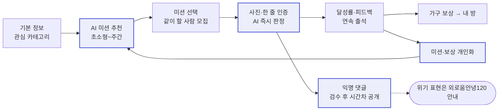

# PRD — 맞춤형 서울챌린지

> 최종 수정: 2026-10-18 · 공모전/해커톤 제출용 MVP · 마감 2026-10-20 · 시각 명세는 [DESIGN.md](./DESIGN.md)

---

## 1. 프로젝트 개요

| 항목 | 내용 |
| --- | --- |
| 이름 | 맞춤형 서울챌린지 |
| 한 줄 설명 | 미션을 할수록 AI가 다음 미션과 보상을 맞춰 주는, 외로운 청년을 위한 초소형 일상 챌린지 |
| 유형 | 크로스플랫폼 앱 — 웹(심사용 링크) 주력, 모바일(Expo Go) 시연 |
| 난이도 | 중상 — AI 3종(미션 생성, 사진 판정, 댓글 검수) + 예약 작업(pg_cron) 연동 |

### 1.1 배경

서울시는 2024년 10월 「외로움 없는 서울」을 발표하며 외로움을 도시가 함께 해결할 사회문제로 규정했다. 외로움안녕120(2025.4~2026.8 누적 상담 약 8만 건), 서울마음편의점(같은 기간 이용자 약 16만 4천 명, 연말 25개소로 확대) 등을 운영 중이다.

### 1.2 문제 정의

1. **도움이 필요하다고 인정하는 것 자체가 장벽이다.**
   - 청년이 도움을 청하지 못하는 가장 큰 이유는 낙인·부끄러움, 자기 상태를 알아차리기 어려움, 혼자 해결하고 싶은 마음이다. [^gulliver]
   - 외로움에는 숨기고 싶은 자기 낙인이 있고 [^barreto], 직접 물으면 실제의 절반 이하로 보고된다(직접 질문 5.9%, 간접 측정 13.1%). [^vandenbroek]
   - 고립·은둔 청년의 62.0%가 타인의 시선을 두려워하고, 81.7%가 '혼자 하는 활동 지원'을 원한다. [^mohw2023] 서울 청년도 심리상담(36.8%)보다 취미·운동 활동(44.7%) 지원을 더 원한다. [^seoul2023]
2. **청년, 특히 청년 남성에게 닿지 않는다.**
   - 외로움안녕120 이용자의 77.6%가 40~60대, 청년은 18.8%다. [^herald2026]
   - 남성은 감정 표현을 꺼리고 부끄러움 때문에 도움 요청을 미룬다. [^yousaf] 고립·은둔 청년 조사 응답자 중 남성은 27.7%였다(자발 응답, 성비 보정 없음). [^mohw2023]
3. **긴급하지 않은 외로움을 다룰 접점이 없다.** 기존 사업은 상담·위기 대응 중심이다.
4. **미션과 보상이 획일적이다.** 기존 365 서울챌린지는 36개 과제가 고정되어 있다.

### 1.3 해결 방향

| 문제 | 해결 | 구현 기능 |
| --- | --- | --- |
| 1 | 앱 어디에도 '외로움·고립·상담' 단어를 쓰지 않는다(§7.2 금칙어) | 전체 |
| 1 | 5분 이내 미션(난이도 1)부터 시작한다 | F2 |
| 2 | 감정 표현 대신 미션·기록·수집으로 참여하게 한다 | F4, F5, F7 |
| 3 | 익명 댓글을 검수 후 시간차로 공개하고, 위기 표현은 외로움안녕120으로 연결한다 | F6 |
| 4 | 기록에 따라 난이도·카테고리·보상을 조정한다 | F2, F8 |

---

## 2. 사용자 시나리오

| 구분 | 정의 |
| --- | --- |
| 1차 타겟 | 서울 거주 또는 생활 청년, 19~39세 |
| 핵심 세그먼트 | 청년 남성 |
| 비대상 | 긴급·위급 상황 — 앱이 대응하지 않고 외로움안녕120으로 안내 |

| 페르소나 | 사용 시점·동기 | 흐름 |
| --- | --- | --- |
| 민수 (27, 남, 취업 준비 2년차) | 저녁. 하루에 하나라도 해냈다는 감각이 필요 | 카테고리 '산책·운동' 선택 → "편의점까지 걸어가 하늘 사진 찍기"(난이도 1) → 사진 인증 통과 → 연속 출석 3일째 '스탠드' 획득 |
| 지은 (31, 여, 서울 이주 1년차) | 주말. 동네에 갈 곳을 만들고 싶음 | 주간 미션 "구립도서관 행사 1회 가기" → '같이 할래요' → 인증 후 익명 댓글 |
| 현우 (23, 남, 은둔 경험) | 아침. 생활 리듬 회복 | "10시 전 창문 열고 한 줄 남기기" → 2회 연속 미완료 → 다음 날 난이도 1 미션으로 조정 |

---

## 3. 기능 목록

| ID | 기능 | 우선순위 | 축소 시 최소 형태 |
| --- | --- | --- | --- |
| F1 | 익명 로그인·온보딩 | P0 | — |
| F2 | AI 미션 추천 | P0 | — |
| F3 | 미션 선택 | P0 | — |
| F4 | 사진·한 줄 인증 | P0 | — |
| F5 | 달성률·연속 출석 | P0 | 주간 피드백 생략 |
| F6 | 익명 댓글 | P0 | 위기 안내는 생략 불가 |
| F7 | 가구 보상·내 방 | P1 | 가구 6종(§6 F7 표) 그대로 |
| F9 | 같이 할 사람 모집 | P1 | 토글 + 인원 수만 |
| F8 | 미션·보상 개인화 | P2 | 규칙 기반 난이도 조정만(AI 요약 생략) |

시간 부족 시 P2 → P1 순으로 축소한다. 제출 후 과제: 다른 사용자의 방 구경, 서울마음편의점 위치 미션, 벽지·바닥 보상, 푸시 알림, 운영자 대시보드.

---

## 4. 기술 스택

| 영역 | 선택 | 비고 |
| --- | --- | --- |
| 언어 | TypeScript (strict) | 앱, Edge Functions(Deno) 공통. DB 타입은 `supabase gen types`로 생성 |
| 앱 | Expo (React Native) + Expo Router | 웹 export 주력 |
| 사진 | expo-image-picker, expo-image-manipulator | 웹 동작 확인 필수 |
| Supabase 프로젝트 | `seoul-challenge` (ref `jpipzrmspryzvjykxefm`, 서울 리전 ap-northeast-2, Free) | |
| 인증 | Supabase Auth 익명 로그인 | |
| DB | Supabase Postgres + RLS | |
| 파일 | Supabase Storage, 버킷 `verifications`(private) | 피드 노출은 signed URL(유효 1시간) |
| 서버 로직 | Supabase Edge Functions | Claude API 키는 함수 환경 변수에만 |
| AI | Gemini API (기본) / Claude API 전환 가능 | Edge Function `_shared/ai.ts` 한 곳에서 호출. `AI_PROVIDER`로 선택, 댓글 검수는 경량 모델 |
| 예약 작업 | pg_cron | 댓글 공개, 문화행사 동기화 |
| 데이터 | 365 서울챌린지 2026년 2기 36개 과제 [^seoulchallenge], 서울 열린데이터광장 문화행사 | 시드 원본 `data/seoul-challenge-2026-2.json` |
| 배포 | EAS Hosting | `npx expo export -p web` → `eas deploy --prod` |
| 시간대 | Asia/Seoul (KST) | 모든 날짜 경계(자정, 주 시작=월요일) 기준 |

---

## 5. 화면 구성

### 5.1 서비스 흐름

강조 노드 = 생성형 AI가 처리하는 단계.

### 5.2 화면 목록

| # | 화면 | 경로 | 표시 요소 | 주요 행동 |
| --- | --- | --- | --- | --- |
| S1 | 시작 | `/welcome` | 서비스명, 소개 1줄 | 시작하기 → 익명 로그인 → S2 |
| S2 | 온보딩 | `/onboarding` | 3단계: 카테고리 → 구 → 하루 가능 시간 | 완료 → F2 호출 → S3 |
| S3 | 홈 | `/` (탭 그룹 index) | 오늘 날짜, 연속 출석 일수, 일일 미션 카드 3개, 주간 미션 카드 1개, '다른 미션 보기' | 카드 탭 → S4 |
| S4 | 미션 상세 | `/mission/[id]` | 제목, 카테고리, 소요 시간, 인증 힌트, 추천 이유(AI), 같이 할래요 인원 | 시작하기 / 인증하기 → S5 |
| S5 | 인증 | `/mission/[id]/verify` | 사진 영역, 소감 입력, 공개 여부 토글, 판정 결과 | 제출 → 결과 → S3 |
| S6 | 피드 | `/(tabs)/feed` | 공개 인증 목록(최신순, 20개 페이지), 공개된 댓글, 빠른 반응 | 댓글 작성 |
| S7 | 기록 | `/(tabs)/record` | 이번 주 달성률, 월간 출석 캘린더, 주간 피드백(AI) | — |
| S8 | 내 방 | `/(tabs)/room` | 방, 슬롯 6개, 보유 가구 목록 | 슬롯 탭 → 가구 선택 → 배치 |
| S9 | 설정 | `/settings` | 닉네임, 카테고리·구·시간 재설정, 도움받을 수 있는 곳 | — |

하단 탭 4개: 홈, 피드, 기록, 내 방. S9는 홈 우상단 버튼으로 진입.

---

## 6. 상세 기능 명세

### F1. 익명 로그인·온보딩

- S1 '시작하기' → `signInAnonymously()` → `profiles` 행 생성.
- 닉네임: `{형용사} {동물}` 자동 생성(형용사·동물 각 20개 목록에서 무작위), 중복 허용. 수정 2~12자.
- 온보딩 입력

| 단계 | 항목 | 값 | 제약 |
| --- | --- | --- | --- |
| 1 | 관심 카테고리 | `walk` 산책·운동 / `food` 요리·식사 / `culture` 문화·전시 / `growth` 자기계발 / `neighborhood` 동네 탐방 / `rhythm` 생활 리듬 / `people` 사람 만나기 | 1~3개 선택 |
| 2 | 생활권 | 서울 25개 구 | 1개 |
| 3 | 하루 가능 시간 | 5 / 15 / 30 (분) | 1개 |

- 완료 기준: 온보딩 저장 후 S3에 미션 카드가 표시됨. F2 실패 시 시드 미션으로 표시.

### F2. AI 미션 추천

- 함수: `recommend-missions`. 호출 시점: 온보딩 완료, 당일(KST) 첫 홈 진입, '다른 미션 보기'(하루 1회).
- 입력: 프로필, 최근 14일 `user_missions`, 시드 36개, 해당 구의 진행 중 문화행사 최대 10건.
- 출력: 일일 3개 + 주간 1개. 각 미션 필드

| 필드 | 타입 | 규칙 |
| --- | --- | --- |
| title | string | 40자 이하, 금칙어(§7.2) 미포함 |
| category | enum | F1 카테고리 7종 |
| difficulty | int | 1~5 |
| minutes | int | 일일: 프로필 하루 가능 시간 이하 |
| verify_hint | string | 30자 이하. 사진에 담길 대상 (예: "하늘이 보이는 사진") |
| reason | string | 50자 이하. 추천 이유, S4에 표시 |
| event_id | uuid \| null | 문화행사 연계 시 |

- 난이도 정의: 1 = 5분, 집 반경 100m / 2 = 15분, 동네 / 3 = 30분, 공공장소 방문 / 4 = 1시간+, 행사 참여 / 5 = 타인과 함께하는 활동.
- 신규 사용자 난이도 1~2. 주간 미션은 프로필 난이도 +1.
- 결과는 `(user_id, KST 날짜)` 기준 캐시. 응답 15초 초과 또는 형식 오류 시 시드에서 카테고리 일치 미션으로 대체.

### F3. 미션 선택

- 카드 '시작하기' → `user_missions.status = in_progress`.
- 유효 기간: 일일 = 당일 23:59 KST, 주간 = 일요일 23:59 KST. 만료 시 `expired`.
- 동시 진행 상한: 일일 3, 주간 1.

### F4. 사진·한 줄 인증

- 입력: 사진 1장(필수, jpg/png/heic, 원본 10MB 이하), 소감(선택, 100자), 공개 여부(기본 비공개).
- 업로드 전 처리: 긴 변 1024px, JPEG 품질 0.8. 경로 `verifications/{user_id}/{uuid}.jpg`.
- 함수 `verify-mission` 판정 결과

| 결과 | 조건 | 처리 |
| --- | --- | --- |
| `pass` | 사진이 `verify_hint`와 관련 있다고 볼 수 있음 (판단이 애매하면 pass) | 미션 `completed`, 보상 판정(F7), 응원 문구 표시 |
| `retry` | 빈 화면, 완전히 무관한 사진, 인터넷 이미지 캡처로 판단됨 | 미션 유지(`in_progress`), 재시도 안내. 횟수 제한 없음 |
| `privacy` | 얼굴 정면, 차량 번호판, 주소가 식별 가능 | `pass`와 동일하게 완료 처리하되 공개 토글 강제 해제 + 안내 |

- 판정 중에는 `judging`. AI 응답 실패·20초 초과 시 `verify_fallback`에 따른다(§8.2). `retry_later`면 `in_progress`로 되돌리고 "확인이 늦어지고 있어요. 잠시 뒤 다시 눌러 주세요." 안내, 같은 인증으로 재시도한다.

### F5. 달성률·연속 출석

- 일 달성률 = 당일 `completed` 일일 미션 수 ÷ 당일 시작한 일일 미션 수.
- 출석: KST 하루에 `completed` 1개 이상.
- 연속 출석: 출석이 끊기면 0으로 초기화. 단, 월~일 주마다 1회 '쉼표'가 자동 적용되어 하루 미출석을 연속으로 인정.
- 연속 출석 보상 시점: 3, 7, 14, 30일.
- 주간 피드백: 매주 월요일 첫 진입 시 지난주 기록으로 1문장(60자 이하) 생성, S7에 표시.

### F6. 익명 댓글

- 대상: 공개된 인증 게시물. 본문 1~200자.
- 상태: `pending` → `approved` | `rejected` | `crisis` → (`approved`만) `published`.

| 단계 | 처리 |
| --- | --- |
| 작성 | `pending`, `publish_at = now() + app_config.comment_delay` 저장. 작성자에게 "약 {N}시간 뒤 공개돼요" |
| 검수 | `moderate-comment`가 즉시 분류 |
| 공개 | pg_cron이 `approved AND publish_at <= now()` → `published` |

| 설정 | 운영 | 시연 |
| --- | --- | --- |
| `comment_delay` | 3시간 | 1분 |
| pg_cron 주기 | `*/10 * * * *` | `* * * * *` |

- `rejected` 기준: 욕설·비하·혐오, 전화번호·SNS 계정·오픈채팅 링크, 광고·외부 URL, 만남 장소·시간 제안. 작성자에게 "이 댓글은 공개되지 않았어요" 표시.
- `crisis` 기준: 자해·자살 암시, 극단적 무망감 표현. 댓글은 비공개, 작성자 화면에 도움 안내 카드 즉시 표시(외로움안녕120 전화 연결 `tel:120`).
- 빠른 반응 3종(검수 없이 즉시 반영, 게시물당 사용자 1회씩): "응원해요", "나도 해볼래요", "멋져요".

### F7. 가구 보상·내 방

- 방 슬롯 6개: `floor-1`, `floor-2`, `wall-1`, `wall-2`, `window`, `desk`. 슬롯 위치와 가구 표현은 DESIGN.md §5.
- 슬롯마다 맞는 `slot_type`의 가구만 배치 가능. 같은 가구는 1개만 보유.
- MVP 가구 6종

| id | 이름 | slot_type | 획득 조건 |
| --- | --- | --- | --- |
| `plant` | 화분 | window | 첫 미션 완료 |
| `lamp` | 스탠드 | desk | 연속 출석 3일 |
| `sofa` | 소파 | floor | 연속 출석 7일 |
| `shoe_rack` | 운동화 선반 | floor | `walk` 카테고리 5회 완료 |
| `clock` | 벽시계 | wall | 첫 주간 미션 완료 |
| `poster` | 전시 포스터 | wall | 문화행사 연계 미션 1회 완료 |

- 획득 즉시 S5 결과 화면에 획득 알림, S8에서 배치.

### F9. 같이 할 사람 모집

- S4 '같이 할래요' 토글 → `mission_participants` 추가/삭제.
- 표시: "같이 하고 싶은 사람 {N}명" + 닉네임 최대 3개.
- 1:1 메시지, 연락처 노출 기능 없음. 피드에서 같은 미션 인증을 같은 묶음으로 표시.

### F8. 미션·보상 개인화

- 실행 조건: 미션 결과(`completed`/`expired`)가 확정될 때마다 DB 트리거(`adjust_difficulty`)가 판단한다.
- 규칙(필수): 연속 2회 `expired` → 난이도 −1, 연속 3회 `completed` → +1. 범위 1~5. 연속 횟수는 마지막 조정(`difficulty_changed_at`) 이후 결과만 센다.
- AI(선택, P2): 기록을 요약해 `preferences`(선호 카테고리 최대 3, 선호 시간대 morning/afternoon/evening) 갱신.
- 보상 개인화: 미획득 가구 중 가장 많이 완료한 카테고리와 연결된 가구를 다음 보상 후보로 표시.

### 6.1 데이터 모델

정의: `supabase/migrations/`. 시드: `supabase/seed.sql` (`scripts/build-seed.py`로 생성).

| 테이블 | 컬럼 |
| --- | --- |
| `profiles` | id(=auth.uid), nickname, categories enum[], district, daily_minutes, difficulty, difficulty_changed_at, preferences, streak, last_attended, rest_used_week, onboarded_at |
| `missions` | id, source(`seed`/`ai`/`event`), seed_no, official_title, official_level, title, category, difficulty, minutes, verify_hint, reason, event_id, created_for(ai 미션 대상자) |
| `daily_recommendations` | (user_id, rec_date) PK, daily_mission_ids, weekly_mission_id, refresh_count(0~1) |
| `user_missions` | id, user_id, mission_id, type(`daily`/`weekly`), status(`in_progress`/`judging`/`completed`/`expired`), due_at, started_at, completed_at, resolved_at(결과 확정 시각) |
| `verifications` | id, user_mission_id, user_id, photo_path, text, ai_result(`pass`/`retry`/`privacy`), ai_message, is_public |
| `mission_participants` | (mission_id, user_id) PK |
| `comments` | id, verification_id, user_id, body, status, publish_at |
| `reactions` | (verification_id, user_id, type) PK, type(`cheer`/`metoo`/`nice`) |
| `furniture` | id, name, slot_type, unlock_rule, sort |
| `user_furniture` | (user_id, furniture_id) PK, slot |
| `events` | id, external_id, district, title, place, url, start_date, end_date |
| `app_config` | key, value (`comment_delay_minutes`) |

권한 (클라이언트 = authenticated 역할)

| 대상 | 클라이언트 허용 | 서버(Edge Function·cron) 전용 |
| --- | --- | --- |
| profiles | 본인 읽기, nickname·categories·district·daily_minutes·onboarded_at 수정 | difficulty, streak, preferences |
| user_missions | 본인 읽기, `in_progress`로 생성 | 상태 변경 |
| verifications | 본인 + 공개 통과건 읽기, 생성(ai_result 없이), is_public 수정(`privacy` 제외) | ai_result, ai_message |
| comments | 본인 + `published` 읽기, verification_id·body만 작성 | status, publish_at(트리거가 설정) |
| user_furniture | 본인 읽기, slot 수정 | 획득(insert) |
| daily_recommendations | 본인 읽기 | 생성·갱신 |
| 타인 닉네임, 같이 할래요 인원 | RPC `get_nicknames`, `get_participant_counts` | — |

DB 함수: `set_demo_mode(bool)` 시연 전환, `publish_due_comments()`, `expire_due_missions()` (cron 10분).
RPC(읽기 전용, 필요한 컬럼만 노출): `get_nicknames`, `get_participant_counts`, `get_participant_nicknames`(최대 3개), `get_feed`(공개 통과 인증 + 미션 제목·닉네임).
Storage: 버킷 `verifications`(private, JPEG, 5MB), 본인 폴더 업로드, 본인 또는 공개 통과건 읽기.

### 6.2 Edge Functions

| 함수 | 입력 | 출력 | 호출 시점 |
| --- | --- | --- | --- |
| `recommend-missions` | user_id | 미션 4개 | F2 |
| `verify-mission` | user_mission_id, photo_path, text | ai_result, message | F4 |
| `moderate-comment` | comment_id | status | 댓글 insert 직후 |
| `sync-events` | — | upsert 건수 | pg_cron 매일 05:00 KST |

---

## 7. 문구 규칙

### 7.1 원칙

- 존댓말 해요체. 한 문장 30자 내외.
- 명령형 대신 제안형: "~해볼래요?", "~해요".
- 실패·미완료를 지적하지 않는다.

### 7.2 금칙어와 대체 표현

| 쓰지 않음 | 대신 |
| --- | --- |
| 외로움, 고립, 은둔, 우울 | (언급하지 않음) |
| 상담, 치료, 극복 | 챌린지, 기록 |
| 실패, 미달성 | "오늘은 쉬어 가요" |
| 다시 하세요 | "다시 해볼까요?" |

예외: 도움 안내 카드와 설정 > 도움받을 수 있는 곳에서는 기관명 '외로움안녕120'을 그대로 쓴다.

### 7.3 고정 문구

| 위치 | 문구 |
| --- | --- |
| S1 소개 | 하루 5분, 서울에서 해보는 작은 챌린지 |
| 판정 `retry` | 미션이 잘 안 보여요. 다시 찍어볼까요? |
| 판정 `privacy` | 얼굴이나 개인정보가 보여서 비공개로 저장했어요 |
| 댓글 대기 | 약 {N}시간 뒤 공개돼요 |
| 도움 안내 카드 제목 | 이야기를 들어줄 곳이 있어요 |
| 홈 미션 없음 | 오늘 미션을 준비하고 있어요 |

---

## 8. 제약사항

### 8.1 일정

| 일자 | 목표 | 완료 기준 |
| --- | --- | --- |
| 10/18 (일) | 스키마·RLS·시드, Expo 셋업, F1 | 웹에서 온보딩 완료 후 S3 진입 |
| 10/19 (월) | F2~F6 | 미션 추천 → 인증 → 댓글 공개까지 웹에서 동작 |
| 10/20 (화) | F7, F9, F8, 배포, 리허설, 제출 | 배포 URL에서 전체 흐름 시연 |

시연 준비: 시연 설정(댓글 1분) 적용, 7일치 기록이 있는 데모 계정 1개, AI 실패 시 시드 대체 동작 확인.

### 8.2 기술

- 필수 기능은 웹에서 동작해야 한다. 네이티브 전용 API 사용 금지.
- AI API 키(`GEMINI_API_KEY`, `ANTHROPIC_API_KEY`)는 Edge Function 환경 변수에만 둔다.
- AI를 쓸 수 없을 때(키·크레딧·장애·시간 초과) 규칙 기반으로 대체하고 앱은 계속 동작한다. 결과에는 `source`/`judged_by`(`ai` | `rule`)를 붙이고, `rule` 결과는 ai-card로 표시하지 않는다.
  - F2 추천: 365 서울챌린지 시드에서 규칙대로 선택해 저장('다른 미션 보기' 포함)
  - F4 판정: `app_config.verify_fallback` = `pass`(통과 처리, 기본값) 또는 `retry_later`(진행 중으로 되돌리고 재시도 안내)
  - F6 검수: 대체하지 않는다. AI 검수에 실패한 댓글은 `pending`으로 남아 공개되지 않는다
- 익명 계정은 기기 간 이전 불가(MVP 범위 외).

### 8.3 안전·윤리

- 실시간 채팅, 1:1 메시지, 연락처 교환 없음.
- 위기 감지는 진단이 아니다. 감지 시 공식 창구 안내만 한다.
- 수집하지 않음: 이메일, 전화번호, 실명, 위치 좌표(구 단위만).
- Gemini 무료 등급은 입력(사진·댓글)이 Google의 제품 개선과 사람 검토에 쓰일 수 있다. 시연 기간에만 쓰고, 실제 운영 전에는 유료 등급 또는 Claude로 전환한다.
- 출처 표기: 365 서울챌린지, 서울 열린데이터광장, Pretendard(OFL) — S9 하단.

### 8.4 미결 사항

- [ ] (제출 후) 보고서 원문으로 국내 수치 재검증

---

## 참고 문헌

[^gulliver]: Gulliver, A., Griffiths, K. M., & Christensen, H. (2010). Perceived barriers and facilitators to mental health help-seeking in young people: a systematic review. *BMC Psychiatry*, 10, 113. <https://doi.org/10.1186/1471-244X-10-113>
[^barreto]: Barreto, M. et al. (2022). Exploring the nature and variation of the stigma associated with loneliness. *Journal of Social and Personal Relationships*, 39(9). <https://pmc.ncbi.nlm.nih.gov/articles/PMC9386761/>
[^vandenbroek]: van den Broek, T., Lam, J., & Potente, C. (2024). Do middle-aged and older people underreport loneliness? Experimental evidence from the Netherlands. *European Journal of Ageing*, 21, 29. <https://doi.org/10.1007/s10433-024-00826-w>
[^yousaf]: Yousaf, O., Grunfeld, E. A., & Hunter, M. S. (2015). A systematic review of the factors associated with delays in medical and psychological help-seeking among men. *Health Psychology Review*, 9(2), 264–276. <https://doi.org/10.1080/17437199.2013.840954>
[^mohw2023]: 서울신문·뉴시스 (2023.12.13). 보건복지부 「2023년 고립·은둔 청년 실태조사」 보도. <https://www.seoul.co.kr/news/society/2023/12/13/20231213500097>, <https://www.newsis.com/view/NISX20231213_0002556616>
[^herald2026]: 헤럴드경제 (2026.4.4). 「"외로워서 전화"…'외로움안녕 120' 이용자 78%, 중장년」. <https://m.news.nate.com/view/20260404n02639>
[^seoulchallenge]: 내 손안에 서울 (2026.8.31). 「외로울 틈 없네! '365 서울챌린지'로 취향대로 골라 도전」 — 2기(2026.9.1~11.30) 36개 챌린지 목록. <https://mediahub.seoul.go.kr/archives/2019234>
[^seoul2023]: 서울특별시 (2023.1.19). 서울시 고립·은둔청년 실태조사 결과 발표. <https://news.seoul.go.kr/gov/archives/544738>
