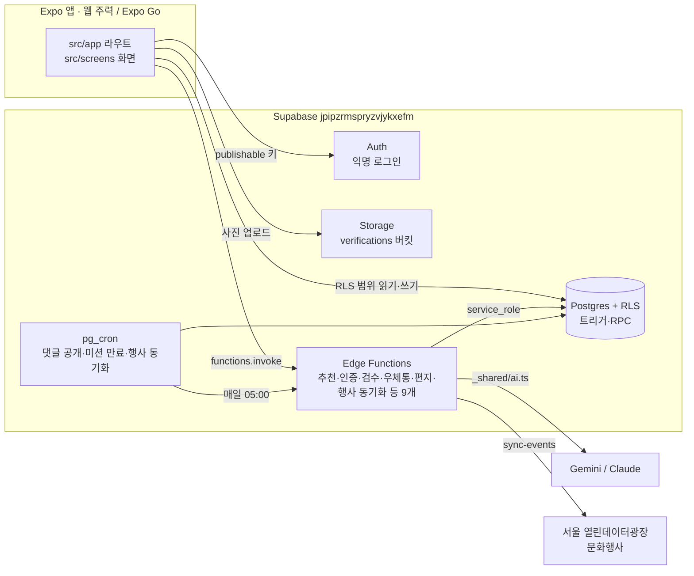

# 구조와 현재 상태

> 코드를 처음 여는 사람이 "어디에 무엇이 있는지"를 빠르게 잡기 위한 지도다. 남은 작업은 [ROADMAP.md](./ROADMAP.md). 기능 정의는 [PRD.md](../PRD.md), 화면 모양은 [DESIGN.md](../DESIGN.md), 작업 배정은 [ROADMAP.md](./ROADMAP.md), 설정값은 [ENV.md](./ENV.md).

## 1. 시스템 구성

- 앱은 RLS가 허용하는 범위만 직접 읽고 쓴다. 상태 전환(미션 완료, 판정, 검수, 보상)은 함수나 DB 트리거만 한다(PRD §6.1 권한 표).
- AI는 함수 안의 `_shared/ai.ts` `generateJson` 하나로만 부른다. 실패하면 규칙 대체(`judged_by`/`source = 'rule'`).
- DB는 운영 프로젝트 하나를 로컬 개발·미리보기·운영이 함께 쓴다. 로컬 Supabase 스택은 쓰지 않는다.

## 2. 폴더 지도

| 경로 | 내용 |
| --- | --- |
| `src/app/` | Expo Router 라우트. 파일 = 화면. 본문은 두지 않고 `src/screens/`를 렌더한다 |
| `src/app/_layout.tsx` | 글꼴 로드, 세션 상태에 따른 `Stack.Protected` 분기(시작 → 온보딩 → 탭), 웹 480px 컬럼 |
| `src/app/(tabs)/_layout.tsx` | 하단 탭 5개(홈·피드·기록·내 방·휴게소) |
| `src/providers/background-audio.tsx` | 빗소리 배경음(expo-audio). 탭을 옮겨도 유지 |
| `src/screens/` | 화면 본문. 큰 화면은 폴더(`feed/`, `onboarding/`, `settings/`) |
| `src/components/` | 공용 UI(`mission-card`, `ai-card`, `help-card`, `growth-card`, `mailbox-card`, `daily-note-card`, `capsule-card` 등). DESIGN.md §5.3 이름과 맞춘다 |
| `src/hooks/` | `use-today-missions`(홈 추천·진행), `use-feed`(피드), `use-theme` |
| `src/providers/session-provider.tsx` | 익명 세션과 `profiles` 행 로드, 삭제된 계정 세션 정리 |
| `src/lib/supabase.ts` | Supabase 클라이언트(환경 변수 읽는 유일한 곳) |
| `src/lib/functions.ts` | Edge Function 호출 래퍼 `Functions.*`와 응답 타입. 새 함수는 여기에 추가 |
| `src/lib/mailbox.ts`, `daily-note.ts`, `capsule.ts` | 우체통·한 줄 기록·타임캡슐 서버 호출 |
| `src/constants/theme.ts` | 디자인 토큰(DESIGN.md와 같은 값) |
| `src/constants/domain.ts`, `room.ts` | 카테고리·구 목록, 방 슬롯 좌표·가구 아이콘 |
| `src/utils/` | KST 날짜(`date.ts`), 시드 미션 고르기, 사진 리사이즈 |
| `src/types/database.ts` | `supabase gen types`로 생성. 직접 수정 금지 |
| `supabase/migrations/` | 스키마·RLS·트리거·RPC·cron. 적용된 파일은 고치지 않는다 |
| `supabase/functions/` | Edge Functions(Deno). `_shared/`: `ai.ts`(AI 호출), `clients.ts`(서버 클라이언트·호출자 확인), `copy.ts`(금칙어), `fallback.ts`, `http.ts`, `kst.ts`, `weekly-letter.ts` |
| `supabase/tests/`, `tests/` | SQL 시나리오 테스트(로컬 DB용), node 테스트(`npm run test:mailbox` 등) |
| `supabase/seed.sql` | 시드(365 서울챌린지 36개 + 가구 6종). `npm run seed:build`로 생성 |
| `data/`, `scripts/build-seed.py` | 시드 원본 JSON과 변환 스크립트 |
| `assets/fonts/` | Pretendard 3종 + 라이선스 |

## 3. 라우트와 구현 상태

| # | 경로 | 화면 파일 | 상태 |
| --- | --- | --- | --- |
| S1 | `/welcome` | `screens/start.tsx` | 완료 |
| S2 | `/onboarding` | `screens/onboarding/` | 완료 |
| S3 | `/` (`(tabs)/index`) | `screens/home.tsx` | 완료. 성장 화분(F11), 마음 우체통(F14), 한 줄 기록(F15), 타임캡슐 메뉴(F16) 반영 |
| S4 | `/mission/[id]` | `screens/mission-detail.tsx` | 완료. 릴레이 표시(F10) 반영 |
| S5 | `/mission/[id]/verify` | `screens/verify.tsx` | 완료. 다음 사람에게 한 줄(F10) 반영 |
| S6 | `/feed` | `screens/feed/` | 완료 |
| S7 | `/record` | `screens/record.tsx` | 완료. 주간 리포트 카드(F13) 반영 |
| S8 | `/room` | `screens/room.tsx` | 완료 |
| S9 | `/settings`, `/settings/[field]` | `screens/settings/` | 완료. 도움 안내·빗소리는 S10으로 옮김 |
| S10 | `/rest` | `screens/rest.tsx` | 완료(T5). 도움 안내 주소는 `constants/help.ts` |
| S11 | `/letter/[week]` | `screens/letter.tsx` | 완료(T8). AI 개인화는 T7 진행 중 |
| S12 | `/capsule`, 홈 시트 | `screens/capsule.tsx` | 완료. 앱에서는 홈 카드 → 시트로 연다 |
| S13 | 홈 시트 | `components/daily-note-card.tsx` | 한 줄 기록·기분(F15). 별도 경로 없음 |

새 Stack 화면은 `src/app/_layout.tsx`의 로그인·온보딩 완료 `Stack.Protected` 블록에 `Stack.Screen`을 추가해야 접근된다.

## 4. 주요 흐름

| 흐름 | 순서 |
| --- | --- |
| 가입 | `signInAnonymously()` → 트리거 `handle_new_user`가 `profiles` 생성(닉네임 자동) → 온보딩 저장(`onboarded_at`) |
| 추천(F2) | 홈 진입 → `Functions.recommendMissions()` → 함수가 당일 `daily_recommendations` 캐시 확인 → 없으면 AI 생성(실패 시 시드) → DB 함수 `save_recommendation`이 한 트랜잭션으로 저장 → 일일 3 + 주간 1 반환 |
| 인증(F4·F5·F7) | 사진 리사이즈 → Storage `verifications/{uid}/…` 업로드 → `verifications` insert(`ai_result` 없음) → `Functions.verifyMission(id)` → AI 판정 후 DB 함수 `finish_verification`이 완료·출석·가구 보상을 한 트랜잭션으로 처리. 같은 요청을 다시 보내면 저장된 응답을 돌려준다 |
| 난이도(F8) | `user_missions` 결과 확정 시 트리거 `adjust_difficulty`(연속 2회 만료 −1, 3회 완료 +1) |
| 댓글(F6) | `submit-comment` 함수(요청 ID로 중복 방지) → 트리거 `prepare_comment`가 `pending`·`publish_at` 설정 → `Functions.moderateComment(id)` → cron `publish_due_comments`가 공개 |
| 릴레이(F10) | 완료한 미션에만 `relay_messages` insert → `moderate-comment`(`relay_id`) 검수 → 같은 cron이 공개 → S4에서 `get_relay_messages` |
| 우체통(F14) | `mailbox` 함수: 보내기 시 AI 검수, 받은 함 조회 시 `receive_mailbox_message`가 승인 글 하나를 한 사람에게 배정 |
| 주간 리포트(F13) | `write-weekly-letter` 함수가 한 줄 기록·완료 미션으로 편지 생성(현재 Gemini일 때만 AI, 그 외 규칙 문구) |
| 만료(F3) | cron `expire_due_missions`(10분) |

DB 함수·RPC: `get_nicknames`, `get_participant_counts`, `get_participant_nicknames`, `get_feed`, `get_relay_messages`, `save_daily_note`, `list_time_capsules`, `send_time_capsule`, `open_time_capsule`, `set_demo_mode`, `publish_due_comments`, `expire_due_missions`. 서버 전용(service_role): `finish_verification`, `save_recommendation`, `start_mission`, `place_furniture`, `submit_comment`, `receive_mailbox_message`. 트리거: `handle_new_user`, `prepare_comment`, `prepare_relay_message`, `check_mission_start`, `check_furniture_slot`, `stamp_mission_resolved`, `adjust_difficulty`, `weekly_letter_version`.

## 5. 알아 둘 점

- **문화행사는 매일 05:00 KST에 동기화된다.** `sync-events`가 서울 열린데이터광장에서 30일 안에 진행되는 행사를 `events`에 넣고, 추천 함수가 사용자 구의 7일 안 행사를 AI에 넘긴다. 키·Vault 설정은 [ENV.md](./ENV.md) B·E절.
- **임시 링크:** 휴게소의 서울마음편의점 행은 구글 검색 URL이다(`src/constants/help.ts`). 공식 URL이 확정되면(PRD §8.4) 이 파일만 바꾼다.
- **테스트는 일부만 있다.** `tests/*.test.mjs`(node)와 `supabase/tests/*.sql`(로컬 DB용, 롤백)이 있다. 그 밖은 `typecheck`·`lint`와 미리보기 배포 수동 확인이다.
- **운영 DB를 함께 쓴다.** 로컬에서 만든 계정·사진도 운영 데이터다. 마이그레이션은 리뷰 후에만 `db push`한다.
- `supabase/config.toml`이 없다. 함수 배포는 매번 `--project-ref jpipzrmspryzvjykxefm`을 붙인다.
- 웹이 주력이다. `Alert.alert`처럼 웹에서 동작하지 않는 API를 필수 흐름에 쓰지 않는다.
