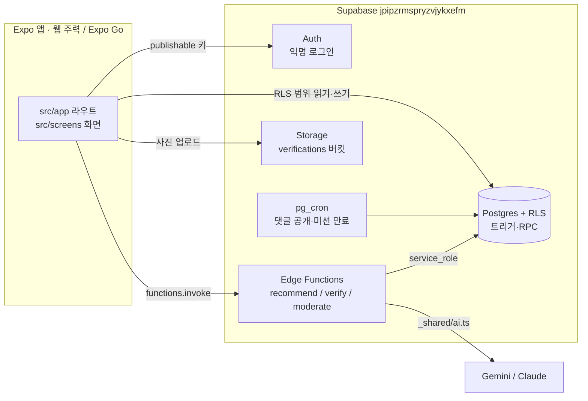

# 구조와 현재 상태

> 기준 2026-10-27, main `96d5ee7`. 코드를 처음 여는 사람이 "어디에 무엇이 있고, 무엇이 끝났고, 무엇이 남았는지"를 빠르게 잡기 위한 지도다. 기능 정의는 [PRD.md](./PRD.md), 화면 모양은 [DESIGN.md](../DESIGN.md), 작업 배정은 [ROADMAP.md](./ROADMAP.md), 설정값은 [ENV.md](./ENV.md).

## 1. 시스템 구성

- 앱은 RLS가 허용하는 범위만 직접 읽고 쓴다. 상태 전환(미션 완료, 판정, 검수, 보상)은 함수나 DB 트리거만 한다(PRD §6.1 권한 표).
- AI는 함수 안의 `_shared/ai.ts` `generateJson` 하나로만 부른다. 실패하면 규칙 대체(`judged_by`/`source = 'rule'`).
- DB는 운영 프로젝트 하나를 로컬 개발·미리보기·운영이 함께 쓴다. 로컬 Supabase 스택은 쓰지 않는다.

## 2. 폴더 지도

| 경로 | 내용 |
| --- | --- |
| `src/app/` | Expo Router 라우트. 파일 = 화면. 본문은 두지 않고 `src/screens/`를 렌더한다 |
| `src/app/_layout.tsx` | 글꼴 로드, 세션 상태에 따른 `Stack.Protected` 분기(시작 → 온보딩 → 탭), 웹 480px 컬럼 |
| `src/app/(tabs)/_layout.tsx` | 하단 탭(현재 4개, T5에서 휴게소 추가) |
| `src/screens/` | 화면 본문. 큰 화면은 폴더(`feed/`, `onboarding/`, `settings/`) |
| `src/components/` | 공용 UI(`mission-card`, `ai-card`, `help-card`, `growth-card` 등). DESIGN.md §5.3 이름과 맞춘다 |
| `src/hooks/` | `use-today-missions`(홈 추천·진행), `use-feed`(피드), `use-theme` |
| `src/providers/session-provider.tsx` | 익명 세션과 `profiles` 행 로드, 삭제된 계정 세션 정리 |
| `src/lib/supabase.ts` | Supabase 클라이언트(환경 변수 읽는 유일한 곳) |
| `src/lib/functions.ts` | Edge Function 호출 래퍼 `Functions.*`와 응답 타입. 새 함수는 여기에 추가 |
| `src/constants/theme.ts` | 디자인 토큰(DESIGN.md와 같은 값) |
| `src/constants/domain.ts`, `room.ts` | 카테고리·구 목록, 방 슬롯 좌표·가구 아이콘 |
| `src/utils/` | KST 날짜(`date.ts`), 시드 미션 고르기, 사진 리사이즈 |
| `src/types/database.ts` | `supabase gen types`로 생성. 직접 수정 금지 |
| `supabase/migrations/` | 스키마·RLS·트리거·RPC·cron. 적용된 파일은 고치지 않는다 |
| `supabase/functions/` | Edge Functions(Deno). `_shared/`: `ai.ts`(AI 호출), `clients.ts`(서버 클라이언트·호출자 확인), `copy.ts`(금칙어), `fallback.ts`, `http.ts`, `kst.ts` |
| `supabase/seed.sql` | 시드(365 서울챌린지 36개 + 가구 6종). `npm run seed:build`로 생성 |
| `data/`, `scripts/build-seed.py` | 시드 원본 JSON과 변환 스크립트 |
| `assets/fonts/` | Pretendard 3종 + 라이선스 |

## 3. 라우트와 구현 상태

| # | 경로 | 화면 파일 | 상태 |
| --- | --- | --- | --- |
| S1 | `/welcome` | `screens/start.tsx` | 완료 |
| S2 | `/onboarding` | `screens/onboarding/` | 완료 |
| S3 | `/` (`(tabs)/index`) | `screens/home.tsx` | 완료. 성장 화분(F11) 반영됨. 타임캡슐 카드·우체통 시트 미구현 |
| S4 | `/mission/[id]` | `screens/mission-detail.tsx` | 완료. 릴레이 표시(F10) 미구현 |
| S5 | `/mission/[id]/verify` | `screens/verify.tsx` | 완료. 다음 사람에게 한 줄(F10) 미구현 |
| S6 | `/feed` | `screens/feed/` | 완료 |
| S7 | `/record` | `screens/record.tsx` | 완료. 편지 카드(F13)·오늘 한 줄(F15) 미구현 |
| S8 | `/room` | `screens/room.tsx` | 완료 |
| S9 | `/settings`, `/settings/[field]` | `screens/settings/` | 완료. "도움받을 수 있는 곳"은 T5에서 S10으로 이동 예정 |
| S10 | `/rest` | — | 미구현(T5, T6) |
| S11 | `/letter/[week]` | — | 미구현(T8) |
| S12 | `/capsule` | — | 미구현(T12, 반영 결정 필요) |

새 Stack 화면은 `src/app/_layout.tsx`의 로그인·온보딩 완료 `Stack.Protected` 블록에 `Stack.Screen`을 추가해야 접근된다.

## 4. 주요 흐름

| 흐름 | 순서 |
| --- | --- |
| 가입 | `signInAnonymously()` → 트리거 `handle_new_user`가 `profiles` 생성(닉네임 자동) → 온보딩 저장(`onboarded_at`) |
| 추천(F2) | 홈 진입 → `Functions.recommendMissions()` → 함수가 당일 `daily_recommendations` 캐시 확인 → 없으면 AI 생성(실패 시 시드) → 일일 3 + 주간 1 반환 |
| 인증(F4·F5·F7) | 사진 리사이즈 → Storage `verifications/{uid}/…` 업로드 → `verifications` insert(`ai_result` 없음) → `Functions.verifyMission(id)` → 판정·완료·출석·가구 보상을 함수가 한 번에 처리 |
| 난이도(F8) | `user_missions` 결과 확정 시 트리거 `adjust_difficulty`(연속 2회 만료 −1, 3회 완료 +1) |
| 댓글(F6) | insert → 트리거 `prepare_comment`가 `pending`·`publish_at` 설정 → `Functions.moderateComment(id)` → cron `publish_due_comments`가 공개 |
| 만료(F3) | cron `expire_due_missions`(10분) |

DB 함수·RPC: `get_nicknames`, `get_participant_counts`, `get_participant_nicknames`, `get_feed`, `set_demo_mode`, `publish_due_comments`, `expire_due_missions`. 트리거: `handle_new_user`, `prepare_comment`, `check_furniture_slot`, `stamp_mission_resolved`, `adjust_difficulty`.

원격 상태(10/27 확인): 마이그레이션 6개가 로컬 파일과 일치, 함수 3개(`recommend-missions`, `verify-mission`, `moderate-comment`) 배포됨(`verify_jwt` 켜짐).

## 5. 남은 작업 요약

자세한 범위·완료 기준·브랜치명은 [ROADMAP.md](./ROADMAP.md) §2~3.

| 묶음 | 작업 | 바로 시작 가능 |
| --- | --- | --- |
| 응원 릴레이(F10) | T1 DB → T2 검수 함수 → T3 화면 | T1 |
| 마음 휴게소(F12) | T5 탭 → T6 빗소리 | T5 (T6은 음원·URL 확정 필요) |
| 주간 편지(F13) | T7 테이블·함수 → T8 화면 | T7 |
| 다음 보상 표시(F8) | T9 | T9 |
| 검토 후 반영 | T10 우체통, T11 한 줄 기록, T12 타임캡슐 | PRD §8.4 결정 후 |
| 마무리 | T13 통합 테스트·데모 계정·리허설 | T1~T9 후 |

## 6. 알아 둘 점

- **문화행사 데이터가 비어 있다.** `sync-events` 함수가 미구현이라 `events` 테이블이 채워지지 않는다. 그래서 행사 연계 미션과 '전시 포스터' 가구(F7)는 지금 얻을 수 없다. ROADMAP에 아직 작업으로 잡혀 있지 않다.
- **임시 링크:** 설정의 서울마음편의점 행은 구글 검색 URL이다. 공식 URL 확정(PRD §8.4) 후 T5에서 `src/constants/help.ts`로 옮긴다.
- **자동 테스트가 없다.** 검사는 `typecheck`·`lint`와 미리보기 배포 수동 확인이다. DB 변경은 SQL로 두 계정 시나리오를 직접 확인한다.
- **운영 DB를 함께 쓴다.** 로컬에서 만든 계정·사진도 운영 데이터다. 마이그레이션은 리뷰 후에만 `db push`한다.
- `supabase/config.toml`이 없다. 함수 배포는 매번 `--project-ref jpipzrmspryzvjykxefm`을 붙인다.
- 웹이 주력이다. `Alert.alert`처럼 웹에서 동작하지 않는 API를 필수 흐름에 쓰지 않는다.
