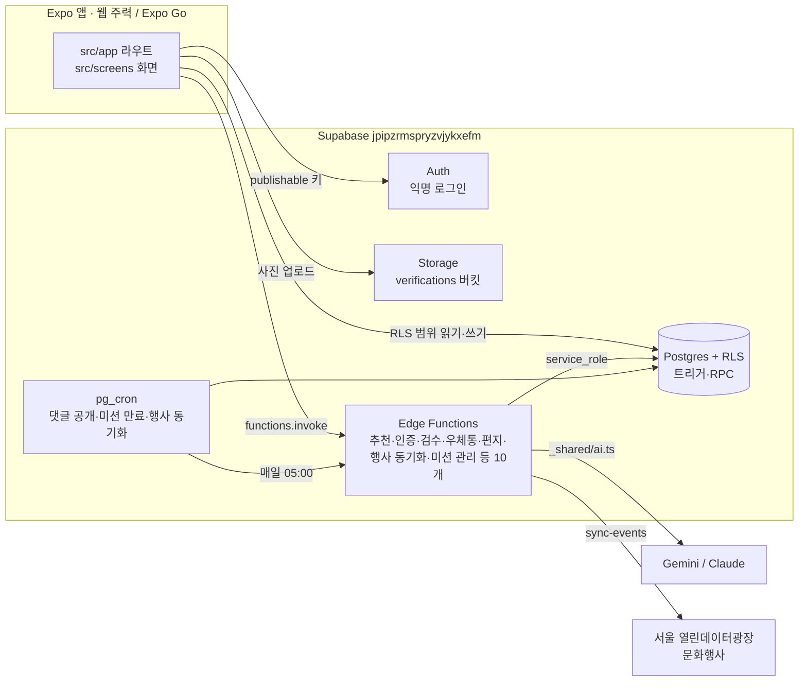

# 구조

> 코드를 처음 여는 사람이 "어디에 무엇이 있는지"를 빠르게 잡기 위한 구현 지도다. 기능이 어떻게 동작해야 하는지는 [openspec/specs/](../openspec/specs/), 화면 모양은 [DESIGN.md](../DESIGN.md), 설정값·시크릿은 아래 9절, 진행 중인 작업은 `openspec list`.
> 구현이 바뀌면(테이블·함수·폴더) 같은 PR에서 이 문서를 고친다.

## 1. 시스템 구성



- 앱은 RLS가 허용하는 범위만 직접 읽고 쓴다. 상태 전환(미션 완료, 판정, 검수, 보상)은 함수나 DB 트리거만 한다(아래 6절 권한 표).
- AI는 함수 안의 `_shared/ai.ts` `generateJson` 하나로만 부른다. 실패하면 규칙 대체(`judged_by`/`source = 'rule'`).
- DB는 운영 프로젝트 하나를 로컬 개발·미리보기·운영이 함께 쓴다. 로컬 Supabase 스택은 쓰지 않는다.

## 2. 폴더 지도

| 경로 | 내용 |
| --- | --- |
| `src/app/` | Expo Router 라우트. 파일 = 화면. 본문은 두지 않고 `src/screens/`를 렌더한다 |
| `src/app/_layout.tsx` | 글꼴 로드, 세션 상태에 따른 `Stack.Protected` 분기(시작 → 온보딩 → 탭), 웹 480px 컬럼 |
| `src/app/(tabs)/_layout.tsx` | 하단 탭 5개(홈·마음 보관함·피드·기록·내 방) |
| `src/providers/background-audio.tsx` | 빗소리 배경음(expo-audio). 탭을 옮겨도 유지 |
| `src/screens/` | 화면 본문. 큰 화면은 폴더(`feed/`, `onboarding/`, `settings/`) |
| `src/components/` | 공용 UI(`bottom-sheet`(모든 시트), `mission-card`, `ai-card`, `help-card`, `growth-card`, `mailbox-card`, `daily-note-card`, `capsule-card` 등). DESIGN.md §5.3 이름과 맞춘다 |
| `src/hooks/` | `use-today-missions`(홈 추천·진행), `use-reward-progress`(다음 보상), `use-feed`(피드), `use-theme` |
| `src/providers/session-provider.tsx` | 익명 세션과 `profiles` 행 로드, 삭제된 계정 세션 정리 |
| `src/lib/supabase.ts` | Supabase 클라이언트와 앱 공개 환경 변수 |
| `src/lib/admin-missions.ts` | 비밀번호를 메모리에서 전달하는 관리자 전용 HTTP 호출. 세션 JWT 대신 서버 비밀번호 검사를 사용 |
| `src/lib/functions.ts` | Edge Function 호출 래퍼 `Functions.*`와 응답 타입. 새 함수는 여기에 추가 |
| `src/lib/mailbox.ts`, `daily-note.ts`, `capsule.ts`, `missions.ts`, `relay.ts`, `verification.ts`, `feed.ts`, `room.ts` | 테이블·Storage·RPC 호출. 화면·컴포넌트·훅은 `supabase`를 직접 부르지 않고 이 파일과 `Functions.*`를 쓴다(예외: 세션을 다루는 `session-provider`) |
| `src/constants/theme.ts` | 디자인 토큰(DESIGN.md와 같은 값) |
| `src/constants/domain.ts`, `room.ts` | 카테고리·구 목록, 방 자리 이름·종류, 가구 획득 조건 문구 |
| `src/constants/room-art.ts`, `room-themes.ts` | 내 방 일러스트 색·시간대 하늘, 벽지·바닥 목록과 잠금 규칙 |
| `src/components/room/` | 내 방 그림(방 배경·가구 일러스트·벽지 무늬), 가구 도감, 가구 받는 순간 |
| `src/utils/room-state.ts` | 시간대·벽시계·화분 단계·도감 남은 조건 계산 |
| `src/utils/` | KST 날짜(`date.ts`), 시드 미션 고르기, 사진 리사이즈 |
| `src/types/database.ts` | `supabase gen types`로 생성. 직접 수정 금지 |
| `supabase/migrations/` | 스키마·RLS·트리거·RPC·cron. 적용된 파일은 고치지 않는다 |
| `supabase/functions/` | Edge Functions(Deno). `_shared/`: `ai.ts`(AI 호출), `clients.ts`(서버 클라이언트·호출자 확인), `copy.ts`(금칙어), `moderation.ts`(댓글·릴레이·우체통 공통 검수), `moderation-privacy.ts`(AI에 보내기 전 개인정보 가리기), `moderation-profanity.ts`(AI 전 욕설 규칙 거절·위기 표현 힌트), `fallback.ts`, `http.ts`, `kst.ts`, `weekly-letter.ts` |
| `supabase/tests/`, `tests/` | SQL 시나리오 테스트(로컬 DB용), node 테스트(전체 `npm test`, 하나만 `npm run test:mailbox` 등) |
| `supabase/seed.sql` | 시드(365 서울챌린지 36개 + 가구 6종). `npm run seed:build`로 생성 |
| `data/`, `scripts/build-seed.py` | 시드 원본 JSON과 변환 스크립트 |
| `assets/fonts/` | Pretendard 3종 + 라이선스 |

## 3. 라우트

화면 번호(S1~S13)는 DESIGN.md §5.2와 spec에서 같은 이름으로 쓴다.

| # | 경로 | 화면 파일 | spec |
| --- | --- | --- | --- |
| S1 | `/welcome` | `screens/start.tsx` | onboarding |
| S2 | `/onboarding` | `screens/onboarding/` | onboarding |
| S3 | `/` (`(tabs)/index`) | `screens/home.tsx` | mission-recommendation, growth-plant, personalization |
| S4 | `/mission/[id]` | `screens/mission-detail.tsx` | mission-lifecycle, mission-together, cheer-relay |
| S5 | `/mission/[id]/verify` | `screens/verify.tsx` | photo-verification, cheer-relay, room-rewards |
| S6 | `/feed` | `screens/feed/` | feed |
| S7 | `/record` | `screens/record.tsx` | attendance-streak, weekly-letter |
| S8 | `/room` | `screens/room.tsx` | room-rewards |
| S9 | `/settings`, `/settings/[field]` | `screens/settings/` | onboarding |
| S10 | `/help` | `screens/help.tsx` | mind-vault의 도움받을 수 있는 곳(스택 화면). 주간 리포트·설정에서 연다. 마음 보관함은 같은 목록(`components/help-place-list.tsx`)을 바텀 시트로 연다. 기관 주소는 `constants/help.ts` |
| S14 | `/vault` | `screens/vault.tsx` | mind-vault의 마음 보관함 탭. 카드가 우체통·한 줄 기록·타임캡슐 시트를 연다. 아래에 빗소리(`components/rain-sound.tsx`)와 도움 안내 링크 |
| S11 | `/letter/[week]` | `screens/letter.tsx` | weekly-letter |
| S12 | `/capsule`, 마음 보관함 시트 | `screens/capsule.tsx` | time-capsule |
| S13 | 마음 보관함 시트 | `components/daily-note-card.tsx` | daily-note. 별도 경로 없음 |
| 관리 | `/admin` | `screens/admin.tsx` | admin-mission-management. 앱 로그인·온보딩과 독립 |

새 Stack 화면은 `src/app/_layout.tsx`의 로그인·온보딩 완료 `Stack.Protected` 블록에 `Stack.Screen`을 추가해야 접근된다.
관리 화면은 이 블록 밖에 있으며 모든 관리 데이터 접근은 서버가 별도로 인증한다. 사용법은 [ADMIN.md](./ADMIN.md).

## 4. 주요 흐름

| 흐름 | 순서 |
| --- | --- |
| 가입 | `signInAnonymously()` → 트리거 `handle_new_user`가 `profiles` 생성(닉네임 자동) → 온보딩 저장(`onboarded_at`) |
| 추천(F2) | 홈 진입 → `Functions.recommendMissions()` → 당일 추천이 없으면 AI 생성(실패 시 기간 내 시드) → DB 함수 `save_recommendation`이 저장·캐시·동일 요청 재시도 모두 KST 기간을 검증하고 무효 항목만 보충 → 일일 최대 3 + 주간 최대 1 반환. 자동 보충은 새로고침 횟수를 유지하며 진행 중 미션의 기한은 바꾸지 않는다 |
| 인증(F4·F5·F7) | 사진 리사이즈 → Storage `verifications/{uid}/…` 업로드 → `verifications` insert(`ai_result` 없음) → `Functions.verifyMission(id)` → 소유권·상태 확인 → 미션의 비공개 기준 사진이 있으면 함께 AI에 전달 → DB 함수 `finish_verification`이 완료·출석·가구 보상을 한 트랜잭션으로 처리. 같은 요청을 다시 보내면 저장된 응답을 돌려준다 |
| 난이도(F8) | `user_missions` 결과 확정 시 트리거 `adjust_difficulty`(연속 2회 만료 −1, 3회 완료 +1) |
| 댓글(F6) | `submit-comment` 함수(요청 ID로 중복 방지) → 트리거 `prepare_comment`가 `pending`·`publish_at` 설정 → `Functions.moderateComment(id)`(AI 분류. 명백한 욕설은 AI가 승인해도 `rejected`. AI를 쓸 수 없을 때는 위기 표현이 없는 욕설 글만 `rejected`, `judged_by: 'rule'`) → cron `publish_due_comments`가 공개 |
| 릴레이(F10) | 완료한 미션에만 `relay_messages` insert → `moderate-comment`(`relay_id`) 검수 → 같은 cron이 공개 → S4에서 `get_relay_messages` |
| 우체통(F14) | `mailbox` 함수: 보내기 시 AI 검수, 받은 함 조회 시 `receive_mailbox_message`가 승인 글 하나를 한 사람에게 배정 |
| 주간 리포트(F13) | `write-weekly-letter` 함수가 한 줄 기록·완료 미션으로 편지 생성(현재 Gemini일 때만 AI, 그 외 규칙 문구) |
| 만료(F3) | cron `expire_due_missions`(10분) |

DB 함수·RPC: `get_nicknames`, `get_participant_counts`, `get_participant_nicknames`, `get_feed`, `get_relay_messages`, `save_daily_note`, `list_time_capsules`, `send_time_capsule`, `open_time_capsule`, `set_demo_mode`, `publish_due_comments`, `expire_due_missions`. 서버 전용(service_role): `finish_verification`, `save_recommendation`, `start_mission`, `place_furniture`, `move_furniture`, `submit_comment`, `receive_mailbox_message`. 트리거: `handle_new_user`, `prepare_comment`, `prepare_relay_message`, `check_mission_start`, `check_furniture_slot`, `stamp_mission_resolved`, `adjust_difficulty`, `weekly_letter_version`.


## 5. 알아 둘 점

- **문화행사는 매일 05:00 KST에 동기화된다.** `sync-events`가 서울 열린데이터광장에서 30일 안에 진행되는 행사를 `events`에 넣고, 추천 함수가 사용자 구의 7일 안 행사를 AI에 넘긴다. 키·Vault 설정은 9.2·9.4절.
- **도움 안내 링크:** 도움받을 수 있는 곳(S10)의 기관 주소는 `src/constants/help.ts` 한 곳에 있다. 기관 페이지가 바뀌면 이 파일만 고친다.
- **테스트는 일부만 있다.** `tests/*.test.mjs`(node, `npm test`)와 `supabase/tests/*.sql`(로컬 DB용, 롤백)이 있다. 그 밖은 `typecheck`·`lint`와 미리보기 배포 수동 확인이다.
- **운영 DB를 함께 쓴다.** 로컬에서 만든 계정·사진도 운영 데이터다. 마이그레이션은 리뷰 후에만 `db push`한다.
- `supabase/config.toml`이 없다. 함수 배포는 매번 `--project-ref jpipzrmspryzvjykxefm`을 붙인다.
- 웹이 주력이다. `Alert.alert`처럼 웹에서 동작하지 않는 API를 필수 흐름에 쓰지 않는다.

## 6. 기술 스택

| 영역 | 선택 | 비고 |
| --- | --- | --- |
| 언어 | TypeScript (strict) | 앱, Edge Functions(Deno) 공통. DB 타입은 `supabase gen types`로 생성 |
| 앱 | Expo (React Native) + Expo Router | 웹 export 주력 |
| 사진 | expo-image-picker, expo-image-manipulator | 웹 동작 확인 필수 |
| 소리 | expo-audio | F12 배경음 |
| Supabase 프로젝트 | `seoul-challenge` (ref `jpipzrmspryzvjykxefm`, 서울 리전 ap-northeast-2, Free) | |
| 인증 | Supabase Auth 익명 로그인 | |
| DB | Supabase Postgres + RLS | |
| 파일 | Supabase Storage, 버킷 `verifications`(private) | 피드 노출은 signed URL(유효 1시간) |
| 서버 로직 | Supabase Edge Functions | AI 키는 함수 시크릿에만 |
| AI | Gemini API (기본) / Claude API 전환 가능 | Edge Function `_shared/ai.ts` 한 곳에서 호출. `AI_PROVIDER`로 선택, 댓글 검수는 경량 모델 |
| 예약 작업 | pg_cron | 댓글 공개, 문화행사 동기화 |
| 데이터 | 365 서울챌린지 2026년 2기 36개 과제 [^seoulchallenge], 서울 열린데이터광장 문화행사 | 시드 원본 `data/seoul-challenge-2026-2.json` |
| 배포 | EAS Hosting | `npx expo export -p web` → `eas deploy --prod` |
| 시간대 | Asia/Seoul (KST) | 모든 날짜 경계(자정, 주 시작=월요일) 기준 |

## 7. 데이터 모델

정의: `supabase/migrations/`. 시드: `supabase/seed.sql` (`scripts/build-seed.py`로 생성).

| 테이블 | 컬럼 |
| --- | --- |
| `profiles` | id(=auth.uid), nickname, categories enum[], district, daily_minutes, difficulty, difficulty_changed_at, preferences, streak, last_attended, rest_used_week, onboarded_at |
| `missions` | id, source(`seed`/`ai`/`event`), seed_no, official_title, official_level, title, category, difficulty, minutes, verify_hint, reason, event_id, created_for(ai 미션 대상자), start_date, end_date(빈 날짜는 제한 없음, KST 양 끝 포함) |
| `mission_photos` | id, mission_id(UUID), storage_path, hint(원본 비교 힌트). RLS 활성화, service_role만 접근 |
| `admin_login_attempts` | 비밀번호와 주소를 함께 해시한 제한 키, 오류 횟수, 제한 시작 시각. RLS 활성화, service_role만 접근. 1일 지난 항목은 다음 검사 시 정리 |
| `daily_recommendations` | (user_id, rec_date) PK, daily_mission_ids, weekly_mission_id, refresh_count(0~1) |
| `user_missions` | id, user_id, mission_id, type(`daily`/`weekly`), status(`in_progress`/`judging`/`completed`/`expired`), due_at, started_at, completed_at, resolved_at(결과 확정 시각) |
| `verifications` | id, user_mission_id, user_id, photo_path, text, ai_result(`pass`/`retry`/`privacy`), ai_message, is_public |
| `mission_participants` | (mission_id, user_id) PK |
| `comments` | id, verification_id, user_id, body, status, publish_at |
| `reactions` | (verification_id, user_id, type) PK, type(`cheer`/`metoo`/`nice`) |
| `furniture` | id, name, slot_type, unlock_rule, sort |
| `user_furniture` | (user_id, furniture_id) PK, slot |
| `events` | id, external_id, district, title, place, url, start_date, end_date |
| `app_config` | key, value (`comment_delay_minutes`, `verify_fallback`) |

F10~F16에서 추가한 테이블.

| 테이블·컬럼 | 컬럼 | 기능 |
| --- | --- | --- |
| `relay_messages` | id, mission_id, category, user_id, body(1~60자), status(`comment_status` 재사용), publish_at, created_at. (mission_id, user_id) 유일 | F10 |
| `mailbox_messages` | id, user_id, request_id, body(1~60자), status(`comment_status`), recipient_id, received_at, read_at, created_at. (user_id, request_id) 유일. 모든 접근은 서버 함수 | F14 |
| `weekly_letters` | (user_id, week_start) PK, body, source, input_hash, finalized, updated_at | F13 |
| `daily_notes` | (user_id, note_date) PK, mood(1~5), text(0~60자), created_at. 날짜는 서버의 한국 시간 기준 | F15 |
| `time_capsules` | id, user_id, body(1~100자), open_on, opened_at, created_at | F16 |

### 권한 (클라이언트 = authenticated 역할)

| 대상 | 클라이언트 허용 | 서버(Edge Function·cron) 전용 |
| --- | --- | --- |
| profiles | 본인 읽기, categories·district·daily_minutes·onboarded_at 수정(nickname도 컬럼 권한은 있으나 앱에 수정 화면 없음) | difficulty, streak, preferences |
| user_missions | 본인 읽기, `in_progress`로 생성 | 상태 변경 |
| verifications | 본인 + 공개 통과건 읽기, 생성(ai_result 없이), is_public 수정(`privacy` 제외) | ai_result, ai_message |
| comments | 본인 + `published` 읽기, verification_id·body만 작성 | status, publish_at(트리거가 설정) |
| user_furniture | 본인 읽기, slot 수정 | 획득(insert) |
| daily_recommendations | 본인 읽기 | 생성·갱신 |
| 타인 닉네임, 같이 할래요 인원 | RPC `get_nicknames`, `get_participant_counts` | — |
| relay_messages | 본인 읽기, mission_id·body만 작성(category·status·publish_at은 트리거) | status, publish_at |
| 타인 릴레이 글 | RPC `get_relay_messages`(본문만) | — |
| mailbox_messages | 클라이언트 직접 접근 불가. `mailbox` 함수가 JWT 본인 확인 후 발신·수신 목록과 본문만 반환 | 검수·수신자 배정·읽음은 서버만 변경 |
| weekly_letters | 본인 읽기 | 생성 |
| daily_notes, time_capsules | 본인 읽기·작성·수정·삭제. 자동 삭제 없음 | — |

DB 함수: `set_demo_mode(bool)` 시연 전환, `publish_due_comments()`, `expire_due_missions()` (cron 10분).
RPC(읽기 전용, 필요한 컬럼만 노출): `get_nicknames`, `get_participant_counts`, `get_participant_nicknames`(최대 3개), `get_feed`(공개 통과 인증 + 미션 제목·닉네임).
Storage: 버킷 `verifications`(private, JPEG, 5MB), 본인 폴더 업로드, 본인 또는 공개 통과건 읽기.

## 8. Edge Functions

`admin-missions`는 공유 비밀번호로 공용 미션과 기준 사진을 관리한다. 비밀번호는 `ADMIN_PASSWORD` 서버 시크릿으로만 설정하며 요청마다 고정 길이 해시를 비교한다. 틀린 입력은 주소별 5회·전체 100회 후 10분 제한한다. 응답은 `no-store`, 사진 미리보기는 5분 서명 URL이다. 이 함수만 `--no-verify-jwt`로 배포하며 기존 사용자 함수의 JWT 검증은 유지한다. `check_admin_attempt`, `admin_delete_mission`, `admin_attach_photo` RPC는 서버 전용이다. 삭제와 4장 제한은 미션 행 잠금 안에서 검사하며 사용자 기록·참여·릴레이·사진이 연결된 미션 삭제를 막는다.

모든 AI 호출은 `_shared/ai.ts`의 `generateJson()`을 거친다. 제공자(`AI_PROVIDER`), 모델 등급(`main`: 추천·판정·편지 / `light`: 검수), 시간 제한, 실패 시 `null` 반환 규칙이 여기 있다. 시간 제한: 추천 25초, 판정 20초, 검수 10초, 편지 25초.

기준 사진 비교는 GeminiPicture의 방식을 기존 판정에 통합했다. `_shared/mission-photos.ts`가 비공개 `mission-photos` 버킷에서 해당 미션의 사진만 읽는다. 최대 4장·각 2 MiB(JPEG·PNG·WebP), 읽기 제한 5초. 제출 사진을 첫 번째로 보내고 나머지를 장소 비교에 사용한다. 사진 없음은 기존 판정이다. 일부라도 누락·초과·형식 오류가 있으면 일부만 비교하지 않고 기준 사진 없이 판정하며 원인을 로그에 남긴다. `verify_fallback`은 AI 판정 자체가 실패했을 때만 쓴다(spec photo-verification). 경로 조회와 업로드는 서버 관리 권한으로만 하며 앱에는 키나 경로를 공개하지 않는다. 테스트 미션은 이관하지 않는다.

2026-11-01 사용자 승인 후 운영 프로젝트 `jpipzrmspryzvjykxefm`에 `20261101090000_mission_photos`·`20261101091000_mission_schedule`를 적용했다. 기존 이력과 일치함을 확인하고 `verify-mission`, `recommend-missions`, `moderate-comment`, `mailbox`, `write-weekly-letter`를 배포했다. 기존 미션 96개와 기존 진행 미션의 상태·기한은 유지됐고, 사진 테이블의 RLS·서버 전용 권한 및 비공개 버킷을 확인했다. DB 타입은 적용 후 운영 스키마에서 재생성했다.

적용 후 운영 SQL 트랜잭션에서 날짜 경계·기간 보정·동일 요청·새로고침 제한·진행 보존을 검증하고 롤백했다. 임시 익명 계정으로 배포 함수의 동시 HTTP 캐시 조회·새로고침 재시도·운영자 기간 변경 후 보정·사진 경로 접근 차단·존재하지 않는 인증의 404를 확인한 뒤 계정과 관련 데이터를 삭제했다. 실제 사진 판정의 정확도·지연·비용과 미리보기 화면 확인은 change의 남은 검증 항목이다.

문제가 생겨 이전 동작으로 되돌릴 때는 배포 전 커밋 `0687a17`의 해당 Edge Functions를 별도 작업 디렉터리에서 다시 배포하고, 기존 `20261028123000_atomic_recommendations.sql`의 `save_recommendation` 정의만 새 롤백 마이그레이션에서 `CREATE OR REPLACE FUNCTION`으로 복구한다. 새 컬럼·사진 테이블·버킷과 이력은 유지해 등록 데이터를 보존한다. 적용된 마이그레이션을 수정하거나 테이블·버킷을 삭제하지 않는다.

| 함수 | 입력 | 출력 | 호출 시점 |
| --- | --- | --- | --- |
| `recommend-missions` | user_id | 미션 4개 | F2 |
| `verify-mission` | user_mission_id, photo_path, text | ai_result, message | F4 |
| `moderate-comment` | comment_id 또는 relay_id | status | 댓글·릴레이 저장 직후 |
| `mailbox` | action(`send`·`inbox`·`sent`·`read`), body·requestId 또는 id | 본인 발신·수신 글, 검수 상태·읽음 | F14 작성·수신함 진입·본문 열기 |
| `write-weekly-letter` | 주차별 본인 기록과 완료 미션으로 편지 생성, 보관된 주차 목록 조회 | — | F13 |
| `sync-events` | — | upsert 건수 | pg_cron 매일 05:00 KST. 서울 열린데이터광장 문화행사 중 30일 안에 진행되는 행사를 저장 |
| `submit-comment` | verificationId, body, requestId | 댓글 행 | F6 댓글 저장(요청 ID로 중복 방지) |
| `start-mission` | missionId, type, dueAt | 진행 중 미션 | F3 시작(동시 진행 상한 검사) |
| `place-furniture` | slot, furnitureId(null이면 비우기), move(true면 옮기기: 자리에 있던 가구와 한 트랜잭션으로 서로 바꿈) | — | F7 배치·옮기기 |

`publish_due_comments()`는 `comments`와 `relay_messages`를 함께 공개한다.

## 9. 설정값과 시크릿

값을 넣는 곳은 네 군데다. 처음 합류했다면 **9.1만 하면 앱이 뜬다.** 나머지는 관리자·DB 담당이 필요할 때 본다. 계정·권한은 [CONTRIBUTING.md](../CONTRIBUTING.md) 1절.

| 구분 | 위치 | 누가 | 언제 필요한가 |
| --- | --- | --- | --- |
| 9.1 앱 환경 변수 | `.env.local` (내 PC, git 제외) | 모든 팀원 | 앱 실행·웹 배포 |
| 9.2 서버 함수 시크릿 | Supabase Edge Function Secrets | 관리자 | AI·공공데이터 키 변경 |
| 9.3 운영 설정값 | DB `public.app_config` | DB 권한자 | 시연 모드, AI 장애 시 판정 방식 |
| 9.4 예약 작업 비밀값 | Supabase Vault | 관리자 | cron이 함수를 부를 때(문화행사 동기화) |

#### 9.1 앱 환경 변수 (`.env.local`)

```bash
cp .env.example .env.local
```

`.env.example`에 실제 값이 이미 들어 있으므로 복사만 하면 된다.

| 변수 | 값 | 출처 | 공개 여부 |
| --- | --- | --- | --- |
| `EXPO_PUBLIC_SUPABASE_URL` | `https://jpipzrmspryzvjykxefm.supabase.co` | Supabase 대시보드 → Project Settings → Data API | 공개 |
| `EXPO_PUBLIC_SUPABASE_PUBLISHABLE_KEY` | `sb_publishable_…` (`.env.example` 참고) | Supabase 대시보드 → Project Settings → API Keys → Publishable key | 공개 |

- 읽는 곳은 `src/lib/supabase.ts` 한 곳이다. 둘 중 하나라도 없으면 앱 시작 시 `EXPO_PUBLIC_SUPABASE_URL / EXPO_PUBLIC_SUPABASE_PUBLISHABLE_KEY가 없습니다` 오류로 멈춘다.
- `EXPO_PUBLIC_` 접두사가 붙은 값은 **번들에 그대로 들어가 누구나 볼 수 있다.** 그래서 publishable 키만 넣는다. 데이터 보호는 키가 아니라 RLS 정책이 맡는다.
- 값을 바꾼 뒤에는 개발 서버를 캐시 없이 다시 띄운다: `npx expo start --clear`.
- 웹 배포(`npx expo export -p web`)는 **배포하는 사람 PC의 `.env.local`** 을 번들에 넣는다. 배포 전에 값이 맞는지 확인한다.
- `.env*.local`은 `.gitignore`에 있다. `.env.example`만 커밋한다.

> 앱에 절대 넣지 않는 값: `service_role` 키, `sb_secret_…` 키, DB 비밀번호, AI API 키. 클라이언트 코드나 `EXPO_PUBLIC_*`에 들어가면 배포된 웹에서 그대로 노출된다.

#### 9.2 서버 함수 시크릿 (Supabase Edge Function Secrets)

AI 호출은 앱이 아니라 Edge Function(`supabase/functions/`)이 한다. 키는 Supabase 프로젝트에만 있고 팀원 PC에는 두지 않는다.

| 이름 | 필수 | 용도 | 읽는 곳 |
| --- | --- | --- | --- |
| `SUPABASE_URL` | 자동 | 서버 클라이언트 주소 | `_shared/clients.ts` |
| `SUPABASE_SERVICE_ROLE_KEY` | 자동 | RLS를 우회하는 서버 전용 키 | `_shared/clients.ts` |
| `GEMINI_API_KEY` | 둘 중 하나 | Gemini 사용. 있으면 기본 제공자 | `_shared/ai.ts` |
| `ANTHROPIC_API_KEY` | 둘 중 하나 | Claude 사용. `sk-ant-`로 시작 | `_shared/ai.ts` |
| `ANTHROPIC_WORKSPACE_ID` | 선택 | 워크스페이스에 묶이지 않은 Anthropic 키일 때 필요 | `_shared/ai.ts` |
| `AI_PROVIDER` | 선택 | `gemini` 또는 `anthropic`으로 강제 선택 | `_shared/ai.ts` |
| `SEOUL_OPEN_API_KEY` | 행사 동기화 시 | 서울 열린데이터광장 일반 인증키. 주소 경로에 들어가므로 로그에 주소를 남기지 않는다 | `sync-events` |
| `SYNC_EVENTS_SECRET` | 행사 동기화 시 | cron만 `sync-events`를 부를 수 있게 하는 비밀값. Vault `sync_events_secret`과 같은 값 | `sync-events` |
| `ADMIN_PASSWORD` | 관리자 웹 사용 시 | 16자 이상 공유 관리자 비밀번호. 앱 환경 변수로 만들지 않는다 | `admin-missions` |

- **자동** 항목은 Supabase가 모든 함수에 넣어 준다. 직접 설정하지 않는다(`SUPABASE_` 접두사는 예약어라 설정도 안 된다).
- 제공자 선택 규칙: `AI_PROVIDER=anthropic` → Claude / `AI_PROVIDER=gemini` → Gemini / 비어 있으면 `GEMINI_API_KEY`가 있을 때 Gemini, 없으면 Claude.
- 사용 모델은 `_shared/ai.ts`의 `Models` 상수에 있다(`main` = 추천·사진 판정·편지, `light` = 댓글·릴레이·우체통 검수).
- 키가 없거나 AI가 실패해도 앱은 멈추지 않는다(spec: mission-recommendation, photo-verification, content-moderation): 추천은 시드 미션, 판정은 `verify_fallback`(9.3), **검수가 필요한 글은 `pending`으로 남아 공개되지 않는다.**
- Gemini 무료 등급은 입력이 Google 제품 개선·사람 검토에 쓰일 수 있다. 실제 참가자를 받기 전에 유료 등급 또는 Claude로 바꾼다(docs/PRODUCT.md 4절).

확인·변경(관리자):

```bash
npx supabase secrets list --project-ref jpipzrmspryzvjykxefm         # 이름과 해시만 보인다
npx supabase secrets set AI_PROVIDER=anthropic --project-ref jpipzrmspryzvjykxefm
# 시크릿을 바꾼 뒤에는 AI를 쓰는 함수를 모두 다시 배포한다
npx supabase functions deploy recommend-missions --project-ref jpipzrmspryzvjykxefm
npx supabase functions deploy verify-mission --project-ref jpipzrmspryzvjykxefm
npx supabase functions deploy moderate-comment --project-ref jpipzrmspryzvjykxefm
npx supabase functions deploy mailbox --project-ref jpipzrmspryzvjykxefm
npx supabase functions deploy write-weekly-letter --project-ref jpipzrmspryzvjykxefm
```

행사 동기화 키를 바꾼 뒤에는 `npx supabase functions deploy sync-events --project-ref jpipzrmspryzvjykxefm`.

AI가 동작하지 않을 때는 대시보드 Edge Functions → 함수 → Logs에서 `ai error` 줄을 본다. 로그에 키 값은 남지 않고 `provider`, `geminiKey: set|missing`, `anthropicKey: ok|malformed|missing` 같은 설정 상태만 남는다.

#### 함수를 내 PC에서 실행할 때 (선택)

`npx supabase functions serve`로 로컬 실행하려면 `supabase/functions/.env`에 위 AI 키를 넣는다. 이 파일은 `.gitignore`에 등록되어 있지만, 커밋 전에 `git status`로 한 번 더 확인한다. 키는 관리자에게 개인 키 발급을 요청하고 공용 키를 복사해 쓰지 않는다.

#### 9.3 운영 설정값 (`public.app_config`)

환경 변수가 아니라 DB에 저장된 값이다. Supabase 대시보드 SQL Editor에서 바꾼다. 앱·함수 재배포 없이 바로 반영된다.

| key | 값 | 기본 | 의미 |
| --- | --- | --- | --- |
| `comment_delay_minutes` | 숫자(분) | `180` | 댓글(F6)·릴레이(F10) 공개 지연 |
| `verify_fallback` | `"pass"` \| `"retry_later"` | `"pass"` | AI 판정 실패 시 통과 처리 / 재시도 안내(F4) |

```sql
select key, value from public.app_config;

select public.set_demo_mode(true);   -- 시연: 공개 지연 1분, 공개 cron 매분
select public.set_demo_mode(false);  -- 운영: 3시간, 10분 주기

update public.app_config set value = '"retry_later"' where key = 'verify_fallback';
```

`comment_delay_minutes`는 직접 고치지 말고 `set_demo_mode`로 바꾼다. cron 주기도 함께 바뀌어야 하기 때문이다.

#### 9.4 예약 작업 비밀값 (Supabase Vault)

cron(`sync-events`, 매일 05:00 KST)이 함수를 부를 때 쓰는 값이다. 마이그레이션 파일에는 값을 넣지 않고 이름만 쓴다.

| Vault 이름 | 값 |
| --- | --- |
| `project_url` | `https://jpipzrmspryzvjykxefm.supabase.co` |
| `publishable_key` | `.env.example`의 publishable 키 |
| `sync_events_secret` | 9.2의 `SYNC_EVENTS_SECRET`과 같은 값 |

등록·확인(SQL Editor, 관리자):

```sql
select vault.create_secret('<값>', '<이름>');                  -- 처음 한 번
select name, created_at from vault.decrypted_secrets;         -- 이름만 확인
select * from cron.job where jobname = 'sync-events';
select status_code, content, created from net._http_response order by created desc limit 5;  -- 최근 호출 결과(6시간 보관)
```

`SYNC_EVENTS_SECRET`을 바꾸면 Vault 값도 같이 바꾼다(`vault.update_secret`). 둘이 다르면 함수가 401을 돌려준다.

#### 9.5 값 조회 위치

| 값 | 어디서 조회하나 | 누가 조회하나 | 어떻게 전달하나 |
| --- | --- | --- | --- |
| `EXPO_PUBLIC_SUPABASE_URL` | Supabase 대시보드 → Project Settings → Data API → Project URL | 누구나 | 전달 불필요(`.env.example`에 있음) |
| `EXPO_PUBLIC_SUPABASE_PUBLISHABLE_KEY` | Supabase 대시보드 → Project Settings → API Keys → Publishable key | 누구나 | 전달 불필요(`.env.example`에 있음) |
| `GEMINI_API_KEY` | Google AI Studio → API keys (<https://aistudio.google.com/apikey>) | 관리자 | 전달하지 않음. 관리자가 Supabase Secrets에 직접 등록 |
| `ANTHROPIC_API_KEY` | Claude Console → Settings → API Keys (<https://console.anthropic.com/>) | 관리자 | 위와 같음 |
| `ANTHROPIC_WORKSPACE_ID` | Claude Console → Settings → Workspaces → 해당 워크스페이스 ID | 관리자 | 위와 같음 |
| `SEOUL_OPEN_API_KEY` | 서울 열린데이터광장 → 로그인 → 인증키 신청 (<https://data.seoul.go.kr/together/mypage/actkeyMain.do>) | 관리자 | 위와 같음 |
| `SYNC_EVENTS_SECRET` | 직접 만든 임의 문자열(예: `openssl rand -hex 32`) | 관리자 | Secrets와 Vault 두 곳에만 넣는다. 전달하지 않음 |
| 등록된 시크릿 이름 확인 | Supabase 대시보드 → Edge Functions → Secrets, 또는 `npx supabase secrets list` | Supabase 멤버 | 값은 다시 볼 수 없고 해시만 보인다 |
| `app_config` 값 | Supabase 대시보드 → Table Editor → `app_config`, 또는 SQL Editor | Supabase 멤버 | 전달 불필요 |
| DB 비밀번호 | **조회 불가.** Project Settings → Database → Reset database password로 재설정만 가능 | 관리자 | 비밀번호 관리자·1회성 비밀 링크. 메신저 금지 |
| Expo 프로젝트 ID | `app.json`의 `owner`, `extra.eas.projectId` | 누구나 | 전달 불필요. 바꾸지 않는다 |

- 재설정한 DB 비밀번호는 기존에 `supabase link` 해 둔 사람도 다시 입력해야 한다. 재설정 전에 팀에 알린다.
- AI 키는 한 번 만든 뒤 콘솔에서도 전체 값을 다시 볼 수 없다. 잃어버리면 새로 발급하고 이전 키는 폐기한다.
