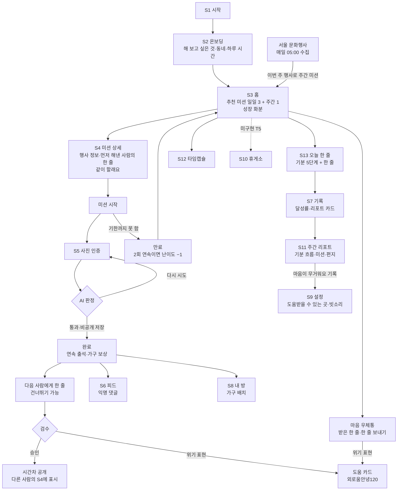

# 사용자 흐름

> 기준 2026-10-28, ROADMAP T14·T15 반영. 페르소나는 [PRD.md](../PRD.md) §2, 화면 번호는 [DESIGN.md](../DESIGN.md) §5.2, 구현 상태는 [ARCHITECTURE.md](./ARCHITECTURE.md) §3. 발표용 여정 지도(감정 곡선)는 이 문서를 바탕으로 따로 만든다.

페르소나 흐름은 **지금 운영 앱에서 실제로 재현되는 것만** 쓴다. 미션 이름은 운영 DB의 시드 미션 또는 AI가 실제로 추천한 미션, 보상은 `furniture` 해금 조건 그대로다. 아직 안 되는 단계는 표에 따로 적는다.

## 1. 기능 구현 상태 (PRD §3 기준)

코드와 운영 DB를 직접 확인했다(10/28).

| ID | 기능 | 상태 | 확인한 근거·남은 것 |
| --- | --- | --- | --- |
| F1 | 익명 로그인·온보딩 | 동작 | 질문 3개: 해 보고 싶은 것(카테고리), 동네, 하루 시간 |
| F2 | AI 미션 추천 | 동작 | AI 미션 108개 생성됨(Gemini). 실패 시 시드 36개에서 고름 |
| F3 | 미션 선택 | 동작 | 일일은 그날 자정, 주간은 그 주 일요일까지 |
| F4 | 사진 인증 | 동작 | AI 판정: 통과·다시 시도·비공개 저장 |
| F5 | 달성률·연속 출석 | 동작 | S7에 이번 주 달성률, 하루 빠져도 주 1회 이어 줌 |
| F6 | 익명 댓글 | 동작 | 검수 후 시간차 공개. 시연 모드라 지금은 1분 |
| F7 | 가구 보상·내 방 | 동작 | 6종 모두 획득 가능. '전시 포스터'는 행사 미션 완료 시 |
| F8 | 난이도 조정 | 동작 | 시작한 미션 2회 연속 만료 시 −1, 3회 연속 완료 시 +1(1~5) |
| F8 | 다음 보상까지 남은 조건 | **미구현** | ROADMAP T9 |
| F9 | 같이 할래요 | 동작 | S4 토글 + 참여 인원 |
| F10 | 응원 릴레이 | 동작 | 공개된 글 2개. 같은 미션이 없으면 같은 카테고리 7일 이내 글 |
| F11 | 성장 화분 | 동작 | 오늘 완료한 일일 미션 0~3개 → 4단계, 동작 줄이기 대응 |
| F12 | 빗소리 | 일부 | **설정(S9)에서** 켜기·볼륨 동작. 휴게소 탭(S10)은 미구현(T5) |
| F13 | 주간 리포트 | 동작 | 실제 기분·한 줄·완료 미션 표시, AI 편지 생성 확인(1건). AI 개인화 고도화는 T7 |
| F14 | 마음 우체통 | 동작 | 받으려면 **다른 사람이 보내 검수된 글**이 있어야 함(지금 대기 0개) |
| F15 | 오늘 한 줄·기분 | 일부 | 저장·수정·삭제 동작. "마음이 무거워요" 3일 연속 안내는 미구현 |
| F16 | 타임캡슐 | 동작 | 7·30·100일. 도착 카드는 그날이 돼야 보임 |
| — | 문화행사 연계 | 동작 | 매일 05:00 수집(10/28 첫 수집 354건, 25개 구). 이번 주 안에 열리는 행사만 주간 미션으로 추천, S4에 행사 정보 표시(T15) |
| — | 휴게소 탭(S10) | **미구현** | 도움 안내는 지금 설정(S9)에 있음 |

## 2. 전체 흐름

점선은 미구현 단계다.

## 3. 페르소나별 흐름

"생각·감정" 열은 발표용 여정 지도의 감정 곡선 재료다. PRD 설명에서 추정한 것이라 팀이 다듬는다.

### 민수 (27, 취업 준비 2년차) — "하루에 하나라도 해냈다는 감각"

온보딩에서 '산책·운동'을 고른다. 짧은 미션을 매일 이어 가며 보상과 화분으로 쌓이는 걸 본다.

| 단계 | 행동 | 화면 | 생각·감정 |
| --- | --- | --- | --- |
| 1 | 추천된 "현관문을 나서며 하늘 사진 한 장 남기기"(난이도 1, 5분)를 고른다 | S3 → S4 | 오늘도 아무것도 안 했다는 무력감 |
| 2 | 먼저 해낸 사람의 한 줄을 읽는다 | S4 | 나만 이런 게 아니구나 |
| 3 | 사진을 찍어 인증하고 통과한다. 첫 미션 보상 '화분'을 받는다 | S5 | 작은 성취 |
| 4 | 다음 사람에게 한 줄을 남긴다 | S5 | 누군가에게 도움이 될 수도 |
| 5 | 홈의 성장 화분이 새싹이 된다 | S3 | 내일도 해 볼까 |
| 6 | 사흘 연속 해내 '스탠드'를 받고, 내 방 책상에 놓는다 | S5 → S8 | 쌓이고 있다는 느낌 |
| 7 | 주말에 주간 리포트에서 한 주의 미션과 편지를 본다 | S7 → S11 | 한 주를 돌아보는 여유 |

'산책·운동'을 5번 완료하면 '운동화 선반'도 받는다. 남은 횟수를 미션 카드에 보여 주는 기능(T9)이 생기면 6단계에 넣는다.

### 지은 (31, 서울 이주 1년차) — "동네에 갈 곳을 만들고 싶다"

온보딩에서 '문화·전시'와 사는 동네를 고른다. 이번 주 동네에서 열리는 행사로 주간 미션을 받아 처음 가 보는 곳에 다녀오고, 모르는 사람과 한 줄을 주고받는다.

| 단계 | 행동 | 화면 | 생각·감정 |
| --- | --- | --- | --- |
| 1 | 이번 주 동네 행사로 만든 주간 미션 "OO 전시 보러 가기"(난이도 4)를 고른다 | S3 → S4 | 아는 곳이 없어 막막함 |
| 2 | 행사 정보 카드에서 기간과 장소를 보고 "행사 정보 보기"로 상세 페이지를 연다 | S4 | 이번 주에 갈 수 있겠다 |
| 3 | '같이 할래요'를 켜고 참여 인원을 본다 | S4 | 혼자 가는 게 아니라는 안도 |
| 4 | 행사에 다녀와 안내판이나 리플릿을 찍어 인증한다. '벽시계'(첫 주간 미션)와 '전시 포스터'(행사 미션)를 받는다 | S5 | 생각보다 괜찮았다 |
| 5 | 내 방 벽에 전시 포스터를 건다 | S8 | 다녀온 곳이 방에 남는다 |
| 6 | 피드에서 다른 사람 인증에 익명 댓글을 남긴다 | S6 | 가볍게 연결된 느낌 |
| 7 | 마음 우체통에서 받은 한 줄을 읽고, 한 줄을 보낸다 | S3 우체통 | 낯선 사람의 다정함 |

행사 미션은 AI가 고를 때만 나온다. 이번 주 그 구에 행사가 없거나 AI를 쓸 수 없으면 "서울형 책방 한 곳 가보기" 같은 시드 주간 미션이 나오고, 이때 '전시 포스터'는 받지 않는다. 10/28 테스트에서는 종로구·문화·전시 계정에 행사 연계 주간 미션이 추천됐다.

### 현우 (23, 은둔 경험) — "생활 리듬을 되찾고 싶다"

온보딩에서 '생활 리듬'과 하루 5분을 고른다. 못 해도 앱이 다그치지 않고 속도를 맞추고, 무거운 날에는 도움 안내까지 닿는다.

| 단계 | 행동 | 화면 | 생각·감정 |
| --- | --- | --- | --- |
| 1 | "반려식물이나 반려동물 사진 남기기"(난이도 1, 5분)를 시작한다 | S3 → S4 | 할 수 있을까 |
| 2 | 시작한 미션 3개를 연달아 해내 난이도가 2로 오른다 | S5 | 생각보다 할 만하다 |
| 3 | 조금 어려워진 미션을 시작했지만 이틀 연속 기한을 넘긴다 | — | 또 못 했다 |
| 4 | 난이도가 1로 돌아와 다시 쉬운 미션이 추천된다 | S3 | 다그치지 않는다는 안도 |
| 5 | 오늘 한 줄에 "마음이 무거워요"를 남긴다 | S13 | 말로 하긴 어렵지만 기록은 할 수 있다 |
| 6 | 주간 리포트에서 "도움을 받을 수 있는 곳을 살펴볼까요?"를 보고 설정의 외로움안녕120으로 간다 | S11 → S9 | 필요하면 닿을 곳이 있다 |
| 7 | 잠들기 전 설정에서 빗소리를 켠다 | S9 | 조용히 쉬어도 된다 |
| 8 | 100일 뒤의 나에게 타임캡슐을 보낸다 | S12 | 앞으로를 생각해 본다 |

난이도는 기본값이 1이라 처음부터 낮출 수는 없다. 그래서 2~4단계는 "올랐다가 내려오는" 흐름으로 잡았다. 시작하지 않은 추천은 만료로 세지 않는다. 휴게소 탭(T5)이 생기면 6·7단계는 휴게소로 옮겨진다.

## 4. 페르소나와 기능

| 기능 | 민수 | 지은 | 현우 |
| --- | --- | --- | --- |
| F2 AI 미션 추천 | ● | ● | ● |
| F4 사진 인증 | ● | ● | ● |
| F5 연속 출석 | ● | | ● |
| F6 익명 댓글 | | ● | |
| F7 가구 보상·내 방 | ● 화분·스탠드 | ● 벽시계·전시 포스터 | |
| F8 난이도 조정 | | | ● |
| F9 같이 할래요 | | ● | |
| F10 응원 릴레이 | ● | | |
| F11 성장 화분 | ● | | |
| F12 빗소리 | | | ● |
| F13 주간 리포트 | ● | | ● |
| F14 마음 우체통 | | ● | |
| F15 오늘 한 줄·기분 | | | ● |
| F16 타임캡슐 | | | ● |
| 도움 안내 | | | ● |

## 5. 시연 준비와 결정할 것

시연에서 흐름을 끊김 없이 보여 주려면 아래가 미리 있어야 한다.

| 필요한 것 | 이유 | 방법 |
| --- | --- | --- |
| 페르소나별 데모 계정 3개 | 연속 출석·난이도 변화·주간 리포트는 며칠치 기록이 필요 | ROADMAP T13. SQL로 지난 기록을 만든 계정 |
| 지은 계정의 구에 이번 주 행사 | 행사 미션은 이번 주 안에 열리는 행사로만 만든다 | 시연 전날 `events`에서 그 구의 행사 수 확인. 행사가 많은 구(종로구·중구 등)로 설정 |
| 다른 사람이 보낸 우체통 글 | 지은 5단계. 받을 글이 있어야 배정됨 | 보조 계정으로 미리 보내 검수 통과시키기 |
| 같은 카테고리의 릴레이 글 | 민수 2단계 | 보조 계정으로 미리 남기기(7일 이내) |
| 시연 모드 | 댓글·릴레이 공개를 1분으로 | 지금 켜져 있음. 시연 후 끄기 |

결정할 것:

- [ ] T9(다음 보상까지 남은 조건)를 발표 전에 넣어 민수 6단계에 보여 줄지
- [ ] T5(휴게소 탭)를 발표 전에 넣어 현우 6·7단계를 휴게소로 옮길지
- [ ] "마음이 무거워요" 3일 연속 안내(F15)를 넣을지
