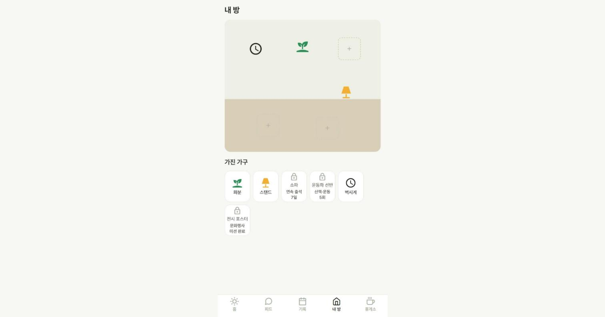
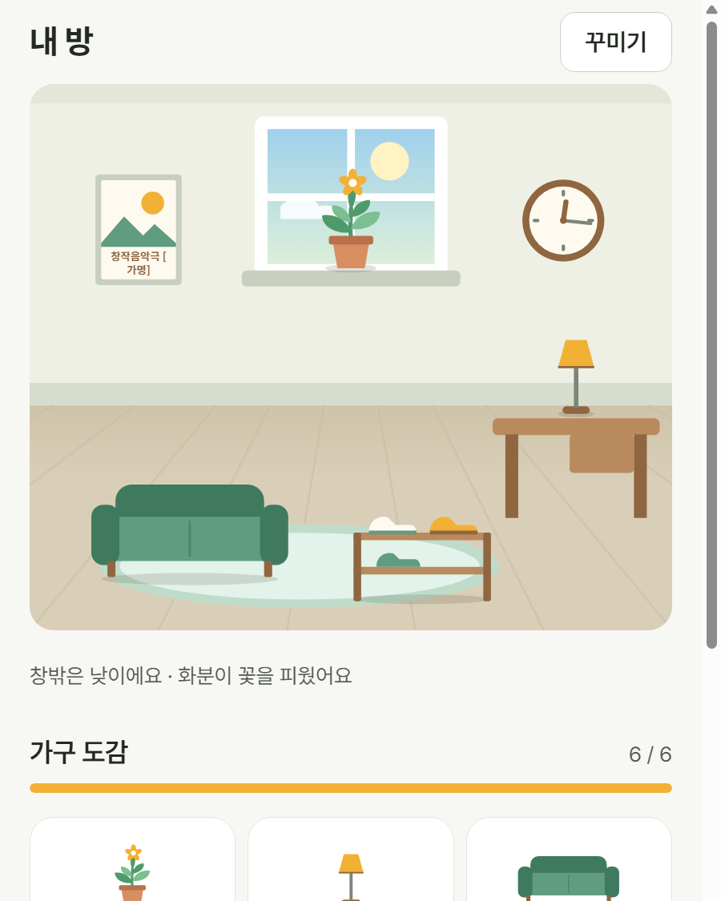
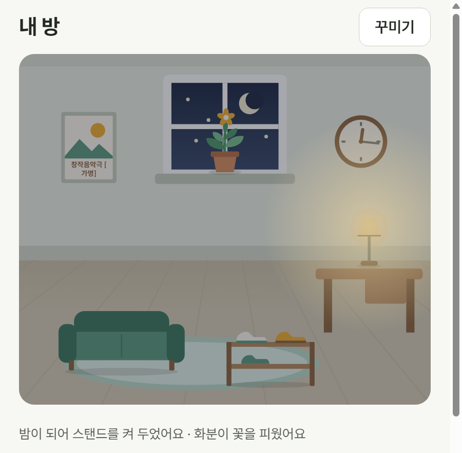
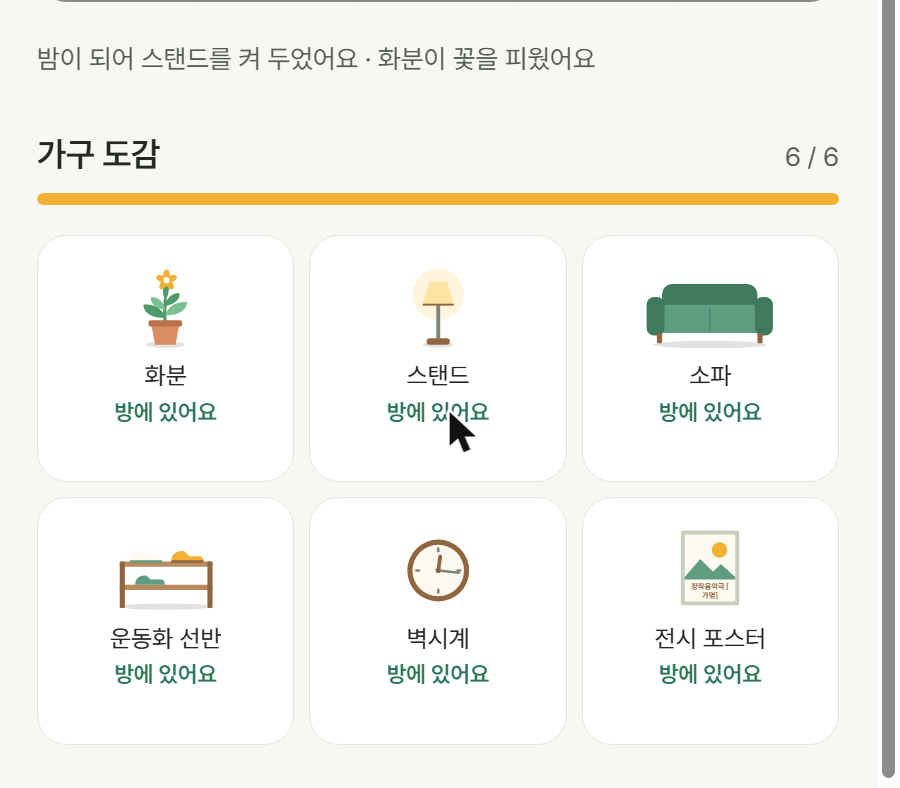

# 제안: 내 방(S8) 다시 그리기

> 시안 브랜치 `proposal/room-redesign`. main에 합치지 않은 제안이다. 팀이 정하면 PRD F7·DESIGN §5.4를 고친 뒤 합친다.

## 왜

지금 내 방은 벽·바닥 사각형 두 개 위에 아이콘 6개를 칸에 놓는 구조다. 기능은 되지만 꾸미는 재미가 약하다.

- **모양**: 가구가 아이콘이고 방에 원근·그림자·빛이 없다. 빈 칸 점선이 늘 보여서 "완성된 방"이 없다.
- **얻는 순간**: 가구를 받아도 인증 결과에 작은 배지 하나가 뜨고 끝난다.
- **모으는 재미**: 잠긴 가구는 자물쇠 아이콘뿐이고, 얼마나 남았는지 알 수 없다.
- **내 이야기**: 방에 내 기록이 묻어나지 않는다.

## 무엇이 바뀌나

| 지금 | 시안 (낮) | 시안 (밤) |
| --- | --- | --- |
|  |  |  |

1. **방을 그림으로**: 원근 바닥, 걸레받이, 러그, 책상, 창문. 가구는 아이콘 대신 플랫 일러스트(SVG)와 바닥 그림자. 색은 앱의 세이지 그린·크림 톤을 따른다.
2. **시간이 흐르는 방**: 창밖 하늘이 KST 기준 아침·낮·저녁·밤으로 바뀐다. 밤에는 방이 어두워지고 스탠드를 놓았으면 불빛이 퍼진다. 벽시계는 지금 시각을 가리킨다.
3. **내 기록이 남는 가구**: 화분은 연속 출석에 따라 새싹(3일 미만) → 잎(7일 미만) → 꽃(7일 이상)으로 자란다(성장 화분 F11과 같은 흐름). 전시 포스터에는 마지막으로 다녀온 행사 이름이 적힌다.
4. **보기와 꾸미기 분리**: 평소에는 깔끔한 방만 보이고, "꾸미기"를 누를 때만 자리 표시가 나온다. 자리를 눌러 가구를 고르거나, "다른 자리로 옮기기"로 같은 종류의 다른 자리로 옮긴다(자리에 가구가 있으면 서로 바꾼다).
5. **가구 도감**: 모은 가구는 그림·받은 날·"방에 있어요", 잠긴 가구는 실루엣·획득 조건·남은 횟수("2번 더 하면 받아요"). 위에 모은 비율 막대.
6. **얻는 순간**: 인증으로 가구를 받으면 상자가 흔들리고 열리며 가구가 나온다. "방에 놓기"를 누르면 내 방으로 가서 빈 자리에 바로 놓는다.

## 범위와 하지 않은 것

- **DB·서버는 바꾸지 않았다.** 가구 6종, 6개 자리, 획득 규칙(`finish_verification`), 배치 함수(`place-furniture`)를 그대로 쓴다. 운영 DB를 함께 쓰므로 시안이 운영 데이터에 영향을 주지 않게 했다.
- 벽지·바닥 무늬 보상, 가구 추가·색 변형, 다른 사람 방 구경은 DB 변경이 필요해 넣지 않았다(PRD 이후 과제).
- 끌어서 옮기기(드래그)는 넣지 않고 "자리 누르기 → 옮기기"로 했다. 화면 읽기 사용자도 같은 방법으로 옮길 수 있고, 제스처 루트 설정을 앱 전체에 추가하지 않아도 된다.
- 일러스트 색(`src/constants/room-art.ts`)은 아직 DESIGN.md 토큰이 아니다. 채택하면 토큰으로 옮긴다.

## 바뀐 파일

| 파일 | 내용 |
| --- | --- |
| `src/components/room/room-scene.tsx` | 방 배경(벽·바닥·창문·책상·러그), 밤 조명 층, 자리 기준점 |
| `src/components/room/furniture-art.tsx` | 가구 6종 일러스트, 화분 단계·스탠드 불빛·시계 바늘·포스터 제목 |
| `src/components/room/collection.tsx` | 가구 도감 |
| `src/components/room/reward-reveal.tsx` | 가구 받는 순간(상자 열기) |
| `src/constants/room-art.ts` | 일러스트 색(라이트·다크), 시간대별 하늘 |
| `src/utils/room-state.ts` | 시간대·시계·화분 단계·남은 조건·조사 계산 |
| `src/screens/room.tsx` | 보기·꾸미기 모드, 옮기기, "방에 놓기"로 들어오면 자동 배치 |
| `src/screens/verify.tsx` | 가구를 받으면 상자 열기 표시 |
| `package.json` | `react-native-svg` 추가(Expo Go 포함 모듈) |

## 확인 방법

- 미리보기 주소에서 내 방 탭을 연다. `/room?time=night`처럼 `morning`·`day`·`evening`·`night`를 붙이면 시간대를 바꿔 볼 수 있다(시안 확인용).
- 확인한 것: 웹(라이트)에서 빈 방, 가구 5개·6개 방, 밤 화면, 꾸미기·옮기기(서로 바꾸기), 도감 잠김·남은 조건, 인증 → 상자 열기 → 방에 놓기 자동 배치. typecheck·lint 통과.
- 아직 확인하지 않은 것: 다크 모드, 휴대폰(Expo Go) 화면.

## 정해야 할 것

1. 이 방향(플랫 일러스트 + 시간·기록이 묻는 방)으로 갈지
2. 다음 단계로 벽지·바닥 보상과 가구 추가(DB 변경)를 할지, 한다면 어떤 미션과 묶을지
3. 일러스트 색을 DESIGN.md 토큰으로 올릴지
